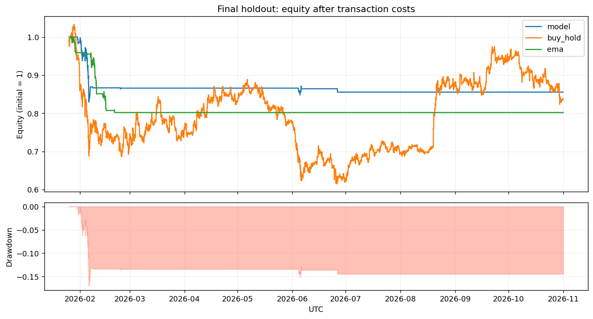
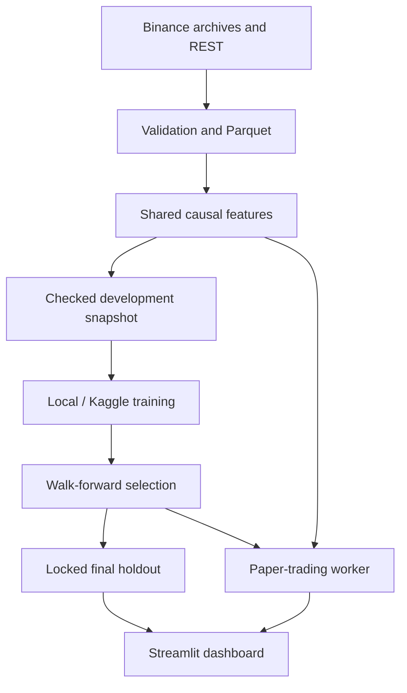

# QuantStream

[](https://github.com/taiiswibu/quantstream-crypto-research/actions/runs/42843857323)

**Local-first crypto forecasting, reproducible ML research and paper trading.**

QuantStream turns public BTC/USDT and ETH/USDT candles into checked research snapshots, compares classical ML and a PyTorch TCN, evaluates trading rules after costs, and runs a local paper-trading dashboard. A separate Chronos-2 LoRA experiment compares pretrained and fine-tuned forecasts.

**Research status:** the reference TCN strategy lost **14.46% after costs** on its final holdout. LoRA did not improve sampled validation MAE. This is an executable research project, not evidence of a profitable strategy.



## Implemented capabilities

| Area | Implementation |
|---|---|
| Data engineering | 92 Binance monthly archives; SHA-256 checks; UTC normalization; quarantine; duplicate conflicts; gap-aware features |
| Research | 18 causal features; shared asset-time splits; purged label boundaries; three walk-forward folds |
| Models | Ridge, Logistic, XGBoost, causal PyTorch TCN; budgeted Optuna search adds GRU |
| Fine-tuning | Chronos-2 LoRA; pinned base revision; controlled steps/LR lab; development-only comparison |
| Backtest | Long/cash; delayed entry; fixed holding; fees/slippage; non-overlap; per-asset drawdown halt |
| Runtime | Public REST catch-up; late-signal rejection; Streamlit; feature PSI; delayed prediction-quality monitoring |
| Reproducibility | Config/data/code contracts; model hashes; Git SHA and dirty-tree provenance; final-test lock |
| Development | Tests; Linux/Windows CI configuration; notebook validation; issue and PR templates |

Reference experiments ran locally on CPU. The [first uploaded Kaggle TCN artifact](docs/experiments/run-001-kaggle-tcn.md) reports CUDA training; checkpoint hashes and development strategy metrics were verified. The observed eight-epoch run deviates from the planned six epochs; notebook URL/GPU model/runtime versions were not captured. No competition score is claimed.

The [12-trial Kaggle model search](docs/experiments/run-002-model-search.md) is now complete; uploaded runtime reports a Tesla T4. TCN's three-seed mean normalized forecast MSE was 0.99306 on tuning folds, versus 0.99382 for tuned Ridge. On the historically observed last development fold, TCN's forecast MSE was worse than zero-return forecasting; strategy return changed from +2.89% at base costs to -0.71% at 1.5x costs. The candidate remains **research only**. Trial/diagnostic prediction metrics were independently recomputed; extra-seed backtests lack saved predictions for independent recomputation. The new controlled LoRA lab remains prepared and unrun.

## Reference outcome

Final period: **2026-01-25 17:00 UTC → 2026-11-01 00:00 UTC**. Source: 67,196 valid hourly candles across BTCUSDT and ETHUSDT, January 2023–October 2026.

| Strategy | Net return | Max drawdown | Hourly Sharpe estimate | Trades |
|---|---:|---:|---:|---:|
| TCN | -14.46% | -17.09% | -2.06 | 46 |
| Buy and hold | -16.41% | -40.46% | -0.30 | 2 |
| EMA | -19.81% | -19.93% | -3.50 | 88 |

Assumptions: 10 bps fee + 5 bps slippage **per side**, one full hourly-bar execution delay, four-hour holding, equal capital sleeves, 95% position fraction. Model/EMA can stay in cash or halt; buy-and-hold stays invested. Exposures differ, so a smaller loss alone does not prove alpha. Sharpe uses unadjusted sqrt(8760) scaling.

TCN's validation advantage over Ridge was small. The final holdout has already been inspected and cannot serve as an unseen test for a revised hypothesis. See [experiment notes](docs/EXPERIMENTS.md) and [original metrics](reports/reference/final_report.json).

## Architecture



Optional WebSocket capture retains closed-candle audit events. The paper runtime uses REST as its canonical catch-up path. Kafka, Spark, a warehouse and broker order execution are outside this local MVP.

## Run from a source checkout

Use Python 3.11 or 3.12. Datasets, weights, local state and large exports are generated locally and ignored by Git; small reference evidence is versioned under `reports/reference`.

Windows PowerShell:

```powershell
py -3.12 -m venv .venv
.\.venv\Scripts\python.exe -m pip install -e .
.\.venv\Scripts\python.exe -m quantstream demo
.\.venv\Scripts\python.exe -m streamlit run app.py
```

Linux/macOS:

```bash
python3.12 -m venv .venv
.venv/bin/python -m pip install -e .
.venv/bin/python -m quantstream demo
.venv/bin/python -m streamlit run app.py
```

`demo` downloads real archives, prepares features, compares classical models and exports Kaggle input. It does not automatically open the final holdout. A fresh checkout creates a new baseline run; the reference TCN weights are outside Git. Existing MVP users can retain their ignored datasets/models when applying the source update.

To train or serve TCN, install CPU PyTorch with your environment's Python:

```bash
python -m pip install torch --index-url https://download.pytorch.org/whl/cpu
```

Continuous simulated runtime: `python -m quantstream paper --watch --poll-seconds 60`. It stops when the process or machine stops. See [Vietnamese local guide](docs/LOCAL_GUIDE_VI.md).

## Git-backed Kaggle training

1. Complete a coherent source/config change, run checks, commit and push.
2. Confirm `git status --short` is clean.
3. Run `python -m quantstream export-kaggle`. Changed feature config, data, split or feature implementation is rejected; rebuild/review the snapshot deliberately.
4. Upload the development-only ZIP to a private Kaggle Dataset.
5. Run [TCN](notebooks/02_Kaggle_TCN.ipynb) or [Chronos LoRA](notebooks/03_Kaggle_Chronos_LoRA.ipynb).
6. Record the actual report, snapshot hash and `source_control.commit` in a new experiment record.

Reports preserve the exported Git SHA, branch and dirty state even without Git inside Kaggle. The old reference runs predate Git tracking and intentionally have no newly assigned source commit.

For the next research cycle, use the **newly exported input ZIP** with [04: model search](notebooks/04_Kaggle_Model_Search.ipynb), then separately [05: controlled LoRA lab](notebooks/05_Kaggle_LoRA_Lab.ipynb). Read the [Vietnamese research walkthrough](docs/RESEARCH_LAB_VI.md). Search uses two early development folds, inner chronological early stopping, a fixed trial budget and a multi-seed shortlist. The historically observed last development fold is a diagnostic, not a new independent holdout. Neither notebook promotes a serving model or places orders.

## Checks and contribution history

```bash
python -m pip install -e ".[dev]"
python -m pytest -q
python -m ruff check quantstream app.py tests scripts
python scripts/check_notebooks.py
```

23 local tests cover causal features, label purging, cost accounting, snapshot integrity, paper behavior, Git provenance and research isolation. Synthetic CPU fits exercise both TCN/GRU; a real-data Ridge smoke run exercises the new two-fold scoring path. These checks do not constitute completed Kaggle search/LoRA experiments. The [first remote CI run](https://github.com/taiiswibu/quantstream-crypto-research/actions/runs/42843857323) passed on both Linux and Windows. The badge reflects subsequent runs. The Linux job includes PyTorch/Optuna; the core Windows job may skip optional deep-learning coverage.

Read [CONTRIBUTING](CONTRIBUTING.md), [Vietnamese Git workflow](docs/GIT_WORKFLOW_VI.md), [roadmap](docs/ROADMAP.md) and [changelog](CHANGELOG.md). Use one branch/PR per coherent change or hypothesis. Commit meaningful work, not an artificial contribution count.

The first commit imports the already completed MVP. Subsequent commits are actual repository improvements. Earlier development dates have not been reconstructed.

## Limitations and credits

Two chosen assets introduce selection bias. OHLCV fills do not model liquidity/capacity. Chronos pretraining overlap is unverified. Future hypotheses require new independent future evaluation.

Architecture inspiration: [ItsLewis-DE/FraudGuard](https://github.com/ItsLewis-DE/fraudguard-streaming-pipeline), commit `5144d6d63dc38b4af0e0a68fd8638f369d35a7a4`; no implementation is copied from that repository. See [third-party notices](THIRD_PARTY_NOTICES.md).

Original application code: [MIT](LICENSE). Data and pretrained models retain their own terms.
