# QuantStream

**Từ dữ liệu thị trường đến mô hình dự báo và ứng dụng theo dõi trên máy cá nhân.**

QuantStream là dự án nghiên cứu dự báo lợi suất BTC/USDT và ETH/USDT từ nến 1 giờ. Dự án kết nối các phần thường bị tách rời trong một bài toán machine learning: thu thập dữ liệu, kiểm tra chất lượng, tạo nhãn theo thời gian, huấn luyện, so sánh baseline, lưu model và đưa dự báo lên web app.

Bộ notebook hiện tại đã được chạy lại trên snapshot **67.820 nến**, gồm **Ridge, XGBoost và TCN**. Kết quả cho thấy Ridge/XGBoost chỉ nhỉnh hơn zero-return một lượng nhỏ về MSE trung bình; chưa ổn định qua từng fold. TCN của lượt này chưa vượt baseline. Ứng dụng đã có luồng inference và mô phỏng, nhưng kết quả nghiên cứu hiện tại **chưa đủ để dùng làm chiến lược đầu tư tiền thật**.

Tác giả: **Võ Văn Tài** · Lĩnh vực: Data Engineering, Time Series Machine Learning, Applied ML.

## Mục lục

1. [Bài toán và giá trị của dự án](#1-bài-toán-và-giá-trị-của-dự-án)
2. [Những phần đã xây dựng](#2-những-phần-đã-xây-dựng)
3. [Kiến trúc và luồng xử lý](#3-kiến-trúc-và-luồng-xử-lý)
4. [Dữ liệu và kiểm tra chất lượng](#4-dữ-liệu-và-kiểm-tra-chất-lượng)
5. [Features, nhãn và chuẩn hóa](#5-features-nhãn-và-chuẩn-hóa)
6. [Chia tập và tránh rò rỉ dữ liệu](#6-chia-tập-và-tránh-rò-rỉ-dữ-liệu)
7. [Mô hình, huấn luyện và siêu tham số](#7-mô-hình-huấn-luyện-và-siêu-tham-số)
8. [Kết quả kiểm định và baseline](#8-kết-quả-kiểm-định-và-baseline)
9. [Mô phỏng chiến lược và chi phí](#9-mô-phỏng-chiến-lược-và-chi-phí)
10. [Lưu model và dự đoán local](#10-lưu-model-và-dự-đoán-local)
11. [Giao diện và ảnh app](#11-giao-diện-và-ảnh-app)
12. [Công nghệ sử dụng](#12-công-nghệ-sử-dụng)
13. [Cài đặt và chạy ứng dụng](#13-cài-đặt-và-chạy-ứng-dụng)
14. [Chạy lại toàn bộ notebook](#14-chạy-lại-toàn-bộ-notebook)
15. [Cấu trúc repository và kiểm thử](#15-cấu-trúc-repository-và-kiểm-thử)
16. [Kinh nghiệm và hướng phát triển](#16-kinh-nghiệm-và-hướng-phát-triển)
17. [Nguồn dữ liệu và bản quyền](#17-nguồn-dữ-liệu-và-bản-quyền)

## 1. Bài toán và giá trị của dự án

Một dự báo chỉ có ý nghĩa khi biết dữ liệu nào đã có tại lúc phát hành, model được huấn luyện đến đâu, sai số so với cách dự báo đơn giản là bao nhiêu và một quyết định giao dịch phải chịu chi phí gì. QuantStream xây dựng quy trình để trả lời các câu hỏi đó.

Tại thời điểm quyết định `D`, hệ thống sử dụng nến đã đóng để dự báo simple return của vị thế giả định vào sau 1 giờ và giữ trong 4 giờ. Đầu ra là một tỷ lệ lợi suất, ví dụ `0.002 = +0,2%`, kèm model/checkpoint và thời điểm dữ liệu. Đây không phải dự báo chính xác giá đóng từng nến.

| Nhu cầu | Cách dự án xử lý | Ứng dụng phù hợp |
|---|---|---|
| Gom dữ liệu thị trường có cấu trúc | Archive/REST → UTC/OHLCV → Parquet và manifest | Xây dựng bộ dữ liệu nghiên cứu có thể kiểm tra lại |
| So sánh mô hình một cách công bằng | Chung cohort, split theo thời gian, purge nhãn, baseline | Thực hành và nghiên cứu time series ML |
| Theo dõi dự báo sau khi train | Artifact có hash → inference CPU → lịch sử forecast | Demo triển khai ML trên máy cá nhân |
| Đánh giá tín hiệu trước khi sử dụng | OOF metrics, từng fold, mô phỏng sau phí, trạng thái chấp nhận | Sàng lọc giả thuyết và tìm nguyên nhân thất bại |
| Trình bày kết quả | Notebook có output, biểu đồ, web app và báo cáo trong README | Portfolio kỹ thuật, báo cáo dự án, thảo luận khi phỏng vấn |

Phạm vi hiện tại là một ứng dụng local cho nghiên cứu và paper trading. Chưa có hạ tầng nhiều người dùng, kết nối đặt lệnh thật, vận hành có SLA hoặc bằng chứng lợi nhuận ổn định ngoài mẫu.

## 2. Những phần đã xây dựng

| Thành phần | Kết quả triển khai |
|---|---|
| Thu thập | Nến Binance public archives/REST; hỗ trợ ghi nhận stream bằng WebSocket riêng |
| Kiểm tra dữ liệu | Kiểm tra schema, UTC, nến đóng, giá/volume, trùng khóa, gap và quarantine |
| Xử lý và lưu trữ | Parquet, manifest SHA256; features được khởi động lại sau khoảng trống |
| Machine learning | Ridge + StandardScaler, XGBoost, TCN nhân quả bằng PyTorch |
| Nghiên cứu | Walk-forward, sàng lọc siêu tham số, logs huấn luyện và báo cáo thí nghiệm |
| Kiểm định | MAE, MSE, MSE/zero-return, directional accuracy, kết quả từng fold |
| Backtest | Long/cash, thời gian chờ thực thi, phí, slippage, tỷ trọng vị thế và drawdown halt |
| Model lifecycle | Lưu weights/scaler/config, kiểm tra hash, registry, import có kiểm tra contract |
| Inference | Dự đoán CPU, kiểm tra độ mới dữ liệu và lưu forecast để chấm khi có nhãn |
| Web app | Năm trang Streamlit; biểu đồ Plotly tương tác và bảng model/data health |
| Kiểm thử | Pytest, Ruff, notebook schema, compile và GitHub Actions trên Linux/Windows |
| Minh chứng | 4 notebook có output đã chạy, 17 biểu đồ/sơ đồ và 6 screenshot app bao quát 5 trang |

Các mô-đun nghiên cứu mở rộng và báo cáo các vòng cũ vẫn được giữ để đối chiếu. Bộ notebook đang sử dụng được rút về bốn bước ở [mục 14](#14-chạy-lại-toàn-bộ-notebook), tránh phải đi qua nhiều notebook phát sinh trong quá trình thử nghiệm.

## 3. Kiến trúc và luồng xử lý

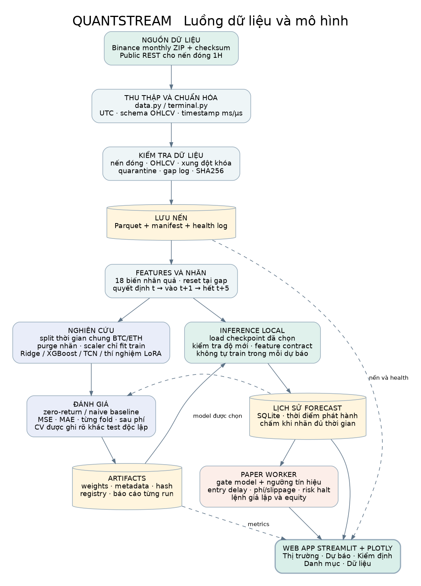

*Hình 1 — Sơ đồ hệ thống được dựng trong notebook dữ liệu. Mã Graphviz nằm ở [architecture.dot](reports/diagrams/architecture.dot).*

Nhánh nghiên cứu đọc snapshot đã kiểm tra, tạo features/nhãn, train theo từng fold rồi lưu model refit cuối. Nhánh vận hành đọc nến mới và checkpoint đã chọn để dự báo; mỗi lần dự báo không tự chạy optimizer. Forecast và paper state được lưu riêng để có thể theo dõi lại quyết định đã phát hành.

| Lớp | Mã nguồn chính | Dữ liệu đi qua |
|---|---|---|
| Ingestion | [data.py](quantstream/data.py), [terminal.py](quantstream/terminal.py), [stream.py](quantstream/stream.py) | Archive ZIP/REST/WebSocket → nến chuẩn hóa |
| Data quality | [history_import.py](quantstream/history_import.py), `validate_bars` | Dữ liệu sạch, quarantine, gap log, source manifest |
| Feature engineering | [features.py](quantstream/features.py) | OHLCV → 18 features, segment và nhãn có mốc thời gian |
| Training | [deep.py](quantstream/deep.py), [workflow.py](quantstream/workflow.py), [final_study.py](scripts/final_study.py) | Fold train → estimator/weights/scaler/logs |
| Validation | [backtest.py](quantstream/backtest.py), [forecast_contract.py](quantstream/forecast_contract.py) | OOF → metrics, equity, trades và trạng thái model |
| Serving | [terminal.py](quantstream/terminal.py), [workflow_model.py](quantstream/workflow_model.py) | Model + features mới → return dự báo |
| Theo dõi | [paper.py](quantstream/paper.py), [risk_reference.py](quantstream/risk_reference.py) | Forecast đã phát hành, nhãn trễ và danh mục giả lập |
| Giao diện | [ui_app.py](quantstream/ui_app.py), [model_ui.py](quantstream/model_ui.py), [risk_ui.py](quantstream/risk_ui.py) | Biểu đồ, bảng kiểm định và thao tác local |

## 4. Dữ liệu và kiểm tra chất lượng

Nguồn lịch sử là **Binance Spot monthly public archives và REST catch-up**. Pipeline tải archive có kiểm tra checksum sidecar, xử lý timestamp mili giây/vi giây về UTC và lưu Parquet. Lượt notebook minh chứng này đọc lại snapshot đã lưu và xác minh SHA256; không tuyên bố đã tải mới toàn bộ lịch sử trong lần chạy đó.

| Thuộc tính snapshot | Giá trị |
|---|---|
| Tài sản / timeframe | BTCUSDT, ETHUSDT / 1H |
| Mở nến đầu tiên | 01/01/2023 00:00 UTC |
| Mở nến cuối cùng | 13/11/2026 23:00 UTC |
| Tổng số nến | 67.820, gồm 33.910 nến mỗi tài sản |
| Nến thiếu | 4: hai nến mỗi tài sản sau 24/03/2023 11:00 UTC |
| Dòng trùng / quarantine | 0 / 0 trong snapshot này |
| SHA256 `bars.parquet` | `1bc980d79b7a5a9c689883aa8d065e67284d7850d605c353dc2ab040ffb1b653` |
| Mẫu có nhãn để refit cuối | 67.608 |

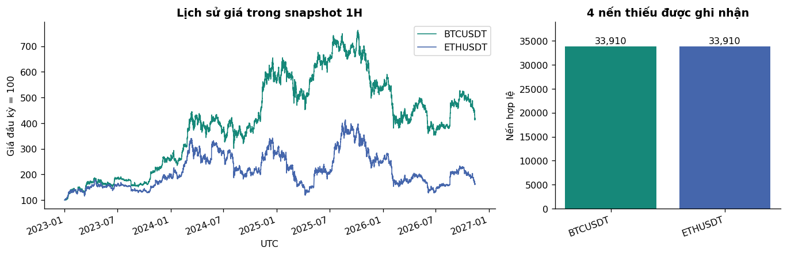

*Hình 2 — Giá chuẩn hóa đầu kỳ bằng 100 và số nến hợp lệ theo tài sản. Đây là dữ liệu của snapshot, không phải ticker live.*

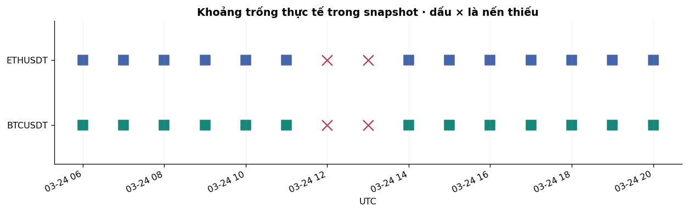

*Hình 3 — Vị trí nến thiếu. Khoảng trống được ghi nhận và rolling features được reset theo segment, không nội suy giá để che gap.*

Kiểm tra chất lượng bao gồm giá hữu hạn/dương, volume không âm, quan hệ high/low với open/close, khóa `symbol + timestamp` và tính đầy đủ của nến. Import lịch sử dừng khi gặp cùng khóa nhưng OHLCV khác nhau. Dòng lỗi được tách khỏi tập sạch, không thay bằng dữ liệu giả. [Snapshot](reports/final_study/snapshot.json) và [data quality](reports/final_study/data_quality.json) là các bản ghi máy đọc được của lượt này.

## 5. Features, nhãn và chuẩn hóa

| Nhóm | Features |
|---|---|
| Return quá khứ | `ret_1`, `ret_4`, `ret_12`, `ret_24` |
| Biến động | `vol_12`, `vol_48`, `atr_14` |
| Động lượng và xu hướng | `rsi_14`, `macd`, `ema_gap` |
| Nến và khối lượng | `volume_z`, `range_pct`, `body_pct`, `taker_ratio` |
| Chu kỳ | `hour_sin`, `hour_cos`, `dow_sin`, `dow_cos` |

Các biến return đầu vào là chênh lệch log giá đóng. Nhãn dự báo là **simple return** theo giá vào/ra giả định:

$$y_D = \frac{P_{exit}}{P_{entry}} - 1$$

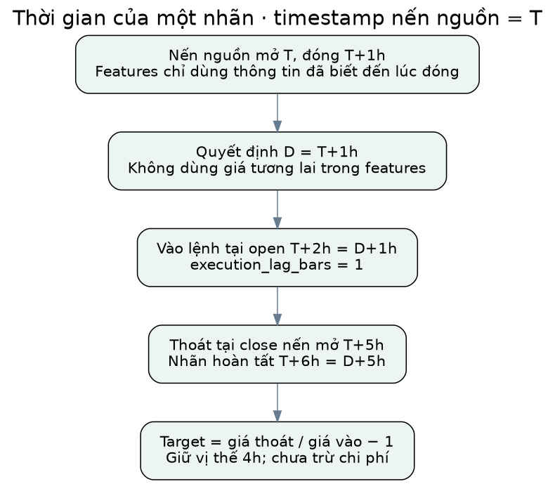

*Hình 4 — Ví dụ nến mở 15:00 đóng lúc 16:00: quyết định 16:00, vào giả định 17:00, thoát 21:00 UTC. Nhãn hoàn tất sau decision time 5 giờ; thời gian giữ vị thế là 4 giờ.*

Ridge dùng `StandardScaler` được fit trên train của từng fold. TCN cũng tính mean/std từ train, rồi áp dụng cho chuỗi validation. XGBoost học trực tiếp trên features. Các dòng cuối chưa có nhãn tương lai vẫn có thể dùng cho inference nếu features đã đầy đủ; chúng không được đưa vào supervised fit.

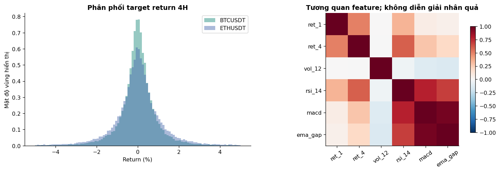

*Hình 5 — Phân phối return và tương quan một số features. Tương quan và importance không chứng minh quan hệ nhân quả.*

## 6. Chia tập và tránh rò rỉ dữ liệu

Ba fold có cùng ranh giới UTC cho BTC và ETH. Mốc đánh giá được xác định từ 90 ngày gần nhất; train được mở rộng về lịch sử từ năm 2023. Không shuffle toàn bộ chuỗi để chia train/test.

Điều kiện giữ nhãn train là `label_end_time < validation_start`. Nhãn validation cũng phải hoàn tất trước điểm kết thúc fold. Vì nhãn có horizon và thời gian chờ thực thi, việc chỉ so `decision_time` sẽ chưa đủ để ngăn nhãn chồng biên.

| Fold | Mẫu train | Mẫu validation | Validation bắt đầu | Kết thúc, không bao gồm |
|---|---:|---:|---|---|
| 1 | 65.700 | 622 | 05/10/2026 07:00 UTC | 18/10/2026 11:00 UTC |
| 2 | 66.332 | 622 | 18/10/2026 11:00 UTC | 31/10/2026 15:00 UTC |
| 3 | 66.964 | 634 | 31/10/2026 15:00 UTC | 14/11/2026 01:00 UTC |

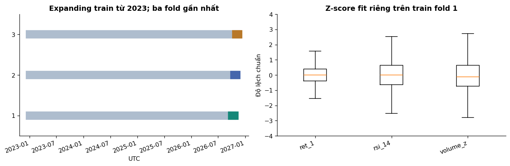

*Hình 6 — Các cửa sổ train/validation và ví dụ z-score. [splits.csv](reports/final_study/splits.csv) ghi cả nhãn train cuối cùng để kiểm tra ranh giới.*

Mỗi model có **1.878 dự báo OOF**, gồm 939 mẫu mỗi tài sản. Nhãn cuối hoàn tất lúc 14/11/2026 00:00 UTC. TCN dùng context features trước biên validation để không mất 47 mẫu đầu; các nhãn context ngoài validation được che đi.

OOF được tạo bởi model của từng fold, trước bước refit cuối. Checkpoint final refit dùng toàn bộ nhãn đã quan sát để minh họa serving, không được dùng để chấm lại quá khứ rồi gọi là ngoài mẫu. Validation này đã phục vụ nghiên cứu; **chưa có final test tương lai độc lập mới**.

## 7. Mô hình, huấn luyện và siêu tham số

### Ridge

Pipeline `StandardScaler → Ridge(alpha=10)` học hồi quy tuyến tính có regularization L2. Đây là baseline nhẹ, phù hợp CPU và dễ kiểm tra hệ số. Ridge không học theo epoch trong cấu hình này; thời gian fit ngắn không có nghĩa là quá trình bị kết thúc sớm.

### XGBoost

Cấu hình cố định: 120 cây, `max_depth=3`, `learning_rate=0.04`, `min_child_weight=30`, `subsample=0.85`, `colsample_bytree=0.85`, `reg_lambda=10`, histogram tree, seed 42 và 4 CPU threads. Objective là squared error. Không dùng activation function như mạng neural.

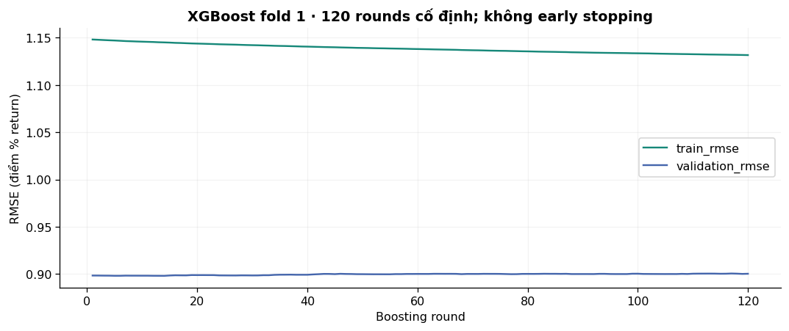

*Hình 7 — RMSE train và validation fold 1 qua 120 boosting rounds. Đường này là lần fit chẩn đoán cùng cấu hình, không dùng early stopping hay chọn vòng tốt nhất theo outer validation.*

### TCN

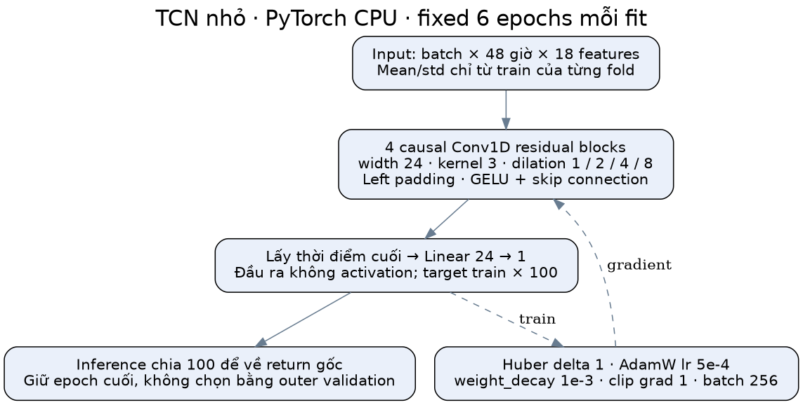

*Hình 8 — TCN nhân quả có residual connections. Các convolution chỉ nhìn quá khứ nhờ left padding.*

| Thiết lập | Giá trị |
|---|---|
| Input | Chuỗi 48 giờ × 18 features |
| Convolution | 4 blocks, width 24, kernel 3, dilation 1/2/4/8 |
| Activation | GELU trong block, cộng skip connection |
| Output | Linear 24 → 1, không activation đầu ra |
| Số tham số | 7.057 |
| Loss / optimizer | Huber `delta=1`; AdamW |
| Learning rate / weight decay | `5e-4` / `1e-3` |
| Batch / gradient clip | 256 / 1,0 |
| Target lúc train | Return × 100; khi inference chia lại 100 |
| Seed / CPU threads | 42 / 4 |
| Epoch | 6 cho mỗi fold và 6 cho final refit |
| Quy tắc checkpoint | Giữ epoch cuối; không chọn epoch bằng outer validation |

Input dài 48 giờ, nhưng bốn lớp convolution hiện tại có receptive field 31 bước tại đầu ra cuối. Tăng lookback đơn thuần không tự làm kiến trúc này nhìn xa hơn; muốn mở rộng cần đổi các block/dilation và đánh giá lại.

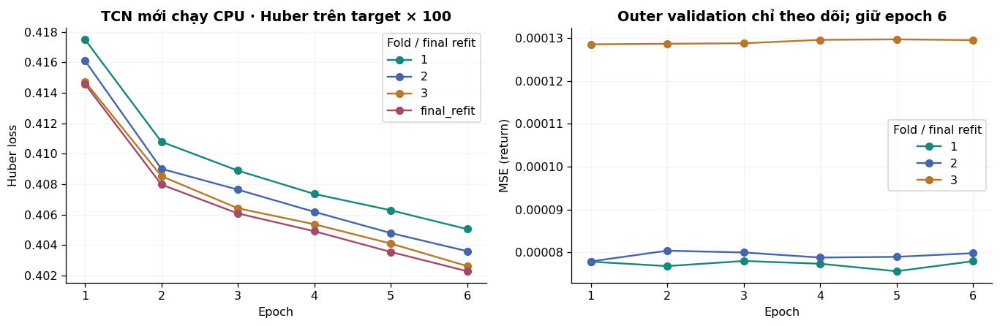

*Hình 9 — Logs thực tế của ba fold và final refit. Tổng cộng 24 epoch và 6.240 optimizer steps, chạy trên CPU. Đây là một cấu hình kiểm chứng, không phải kết quả tìm kiếm toàn bộ không gian TCN.*

Loss train giảm chỉ cho biết mô hình khớp train tốt hơn. Độ hữu ích của dự báo còn phải xem trên validation, baseline và chi phí giao dịch. Huấn luyện lâu hơn không bảo đảm chính xác hơn.

### Thử siêu tham số trên cửa sổ bên trong

Lượt này chạy thêm 6 cấu hình: Ridge `alpha ∈ {1,10,100}` và XGBoost `max_depth ∈ {2,3,5}`. Inner validation dài 28 ngày, nằm hoàn toàn trước outer fold 1; nhãn train được purge tại biên. Các phép thử này minh họa độ nhạy tham số, không dùng để đổi các baseline cố định trong bảng OOF.

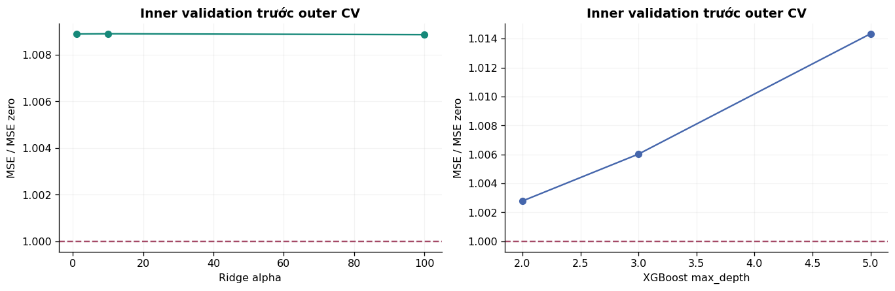

Cả sáu cấu hình ở inner split này có MSE ratio trên 1; đây chưa phải bằng chứng cải thiện.

*Hình 10 — So sánh trên một inner split. [Kết quả thử](reports/final_study/inner_tuning.csv) và [ranh giới inner split](reports/final_study/inner_tuning_split.json). Không gọi đây là nested CV đầy đủ trên cả ba fold.*

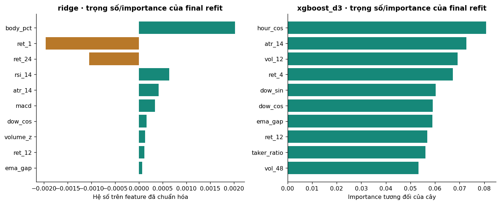

*Hình 11 — Hệ số Ridge trên biến chuẩn hóa và importance tương đối của XGBoost. Đây là mô tả model refit cuối; không dùng để giải thích nhân quả của thị trường.*

## 8. Kết quả kiểm định và baseline

Cả năm phương án dưới đây được chấm trên cùng symbol, decision time và target. MSE ratio dưới 1 nghĩa là sai số bình phương nhỏ hơn dự báo return bằng 0. MAE được trình bày theo **điểm phần trăm return**, không phải phần trăm lợi nhuận.

| Phương án | Số mẫu OOF | MSE / zero-return ↓ | MAE ↓ | Directional accuracy |
|---|---:|---:|---:|---:|
| Ridge | 1.878 | **0,99455** | 0,6204% | 46,70% |
| XGBoost d3 | 1.878 | 0,99826 | 0,6181% | 51,28% |
| TCN fixed 6 | 1.878 | 1,00910 | 0,6289% | 51,81% |
| Zero-return | 1.878 | 1,00000 | **0,6170%** | 53,25% |
| Naive return 4H quá khứ | 1.878 | 2,07162 | 0,9430% | 49,52% |

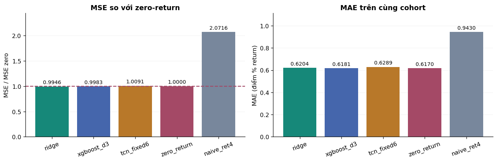

*Hình 12 — MSE ratio và MAE. Nguồn số liệu: [metrics.csv](reports/final_study/metrics.csv).*

Ridge giảm khoảng **0,545% MSE** so với zero-return trên cohort này; XGBoost giảm khoảng **0,174%**. Tuy vậy, cả hai có MAE cao hơn zero-return và chưa thắng trên tất cả các fold. Đây là mức chênh lệch nhỏ, chưa đủ để suy ra lợi thế giao dịch có thể lặp lại.

Directional accuracy ở đây dùng quy tắc `(prediction > 0) == (target > 0)`. Dự báo bằng 0 được tính về nhóm không tăng, nên zero-return có thể đạt 53,25% trong kỳ nhiều nhãn không tăng. Vì vậy một model đạt trên 50% chưa có nghĩa là vượt baseline chiều hướng.

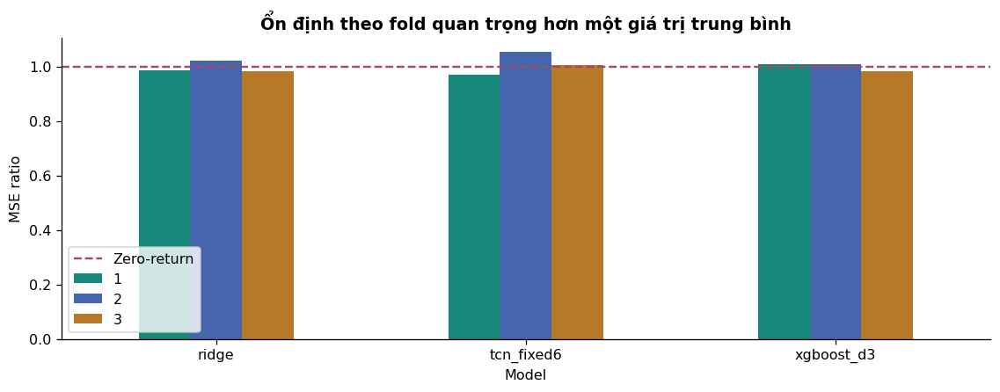

*Hình 13 — [fold_metrics.csv](reports/final_study/fold_metrics.csv) cho thấy độ ổn định theo giai đoạn. Không có model nào thắng zero-return đồng thời ở trung bình và mọi fold.*

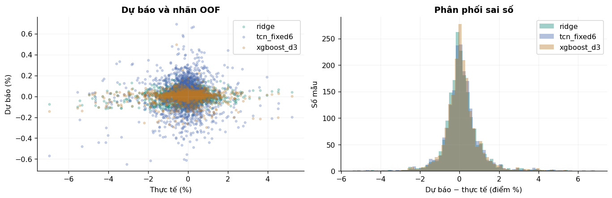

*Hình 14 — Dự báo tập trung gần 0 trong khi return thực tế dao động rộng hơn. Đây là dấu hiệu cần nghiên cứu thêm về sức dự báo của features và regularization; riêng hình này chưa xác định được nguyên nhân.*

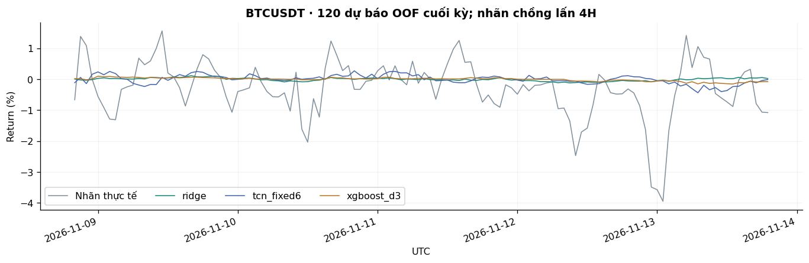

*Hình 15 — 120 mẫu OOF BTCUSDT cuối kỳ, giữ nguyên trục và đơn vị. Nhãn 4H bị chồng lấn giữa các quyết định liên tiếp nên không thể xem mỗi dòng là một quan sát thống kê độc lập.*

Các giới hạn của kết luận hiện tại: chỉ hai tài sản và một cohort validation gần nhất, TCN một seed, các thử nghiệm lịch sử đã quan sát kết quả, chưa có kiểm định chênh lệch sai số với phụ thuộc theo thời gian trong lượt mới. Audit local 20/11 dùng kỳ dữ liệu khác; không trộn số liệu của hai kỳ để gọi là model đã cải thiện.

## 9. Mô phỏng chiến lược và chi phí

Backtest chuyển dự báo thành tín hiệu long/cash. Giả định cố định gồm **10 bps phí + 5 bps slippage mỗi chiều**, tỷ trọng tối đa **10% vốn cho mỗi vị thế**, ngừng nhận lệnh khi chạm drawdown halt **10%**, thời gian vào trễ 1 giờ và giữ 4 giờ. So sánh với buy-and-hold và quy tắc EMA.

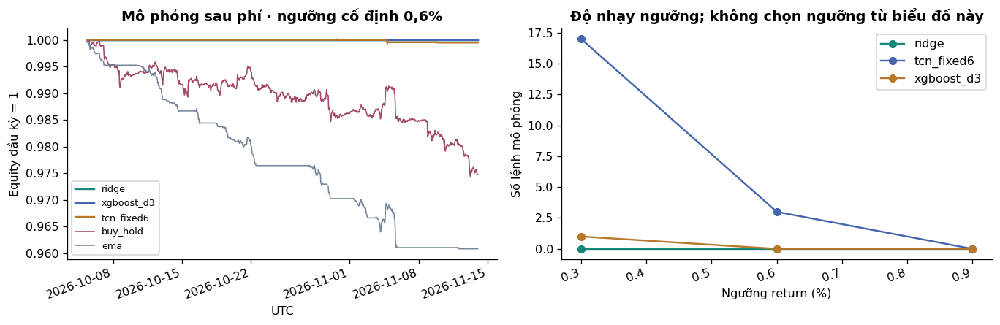

*Hình 16 — Equity tại ngưỡng 0,6% và số lệnh với ba ngưỡng cố định. Không dùng đồ thị độ nhạy để chọn ngưỡng đẹp nhất rồi báo cáo như kết quả độc lập.*

| Model / ngưỡng 0,6% | Số lệnh | Return danh mục mô phỏng |
|---|---:|---:|
| Ridge | 0 | 0,0000% |
| XGBoost | 0 | 0,0000% |
| TCN fixed 6 | 3 | −0,0506% |

Ridge/XGBoost đứng ngoài thị trường trong mô phỏng này. Đường equity phẳng không chứng minh dự báo chính xác hay chiến lược có lợi nhuận. TCN tạo vài lệnh nhưng kết quả sau phí vẫn âm. Các bảng chi tiết được lưu tại [backtests.csv](reports/final_study/backtests.csv) và [strategy_baselines.json](reports/final_study/strategy_baselines.json).

Backtest và paper trading là hai việc khác nhau: backtest tính lại trên dữ liệu lịch sử, paper lưu một phiên vận hành theo thời gian. Cả hai vẫn phụ thuộc giả định khớp lệnh; không mô phỏng đầy đủ order book, market impact hay rủi ro sàn.

## 10. Lưu model và dự đoán local

Notebook huấn luyện lưu Ridge/XGBoost dưới dạng `joblib`, gồm estimator, scaler trong pipeline, thứ tự features và config. TCN lưu `model.pt` chứa `state_dict`, mean/std và lookback. Metadata ghi hash, snapshot, số mẫu, số bước train và vai trò của artifact.

Notebook inference nạp lại các model từ đĩa, đối chiếu SHA256 và so kết quả của hai lần reload. Trên cùng input, chênh lệch tuyệt đối lớn nhất bằng **0** ở cả ba model. Kiểm tra này chứng minh model lưu/nạp nhất quán; không đo độ chính xác tương lai hay tính độc lập giữa hai implementation.

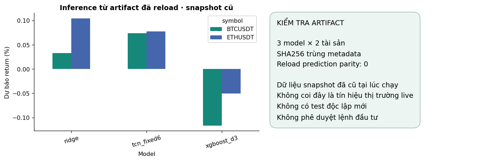

*Hình 17 — Dự báo của các checkpoint refit trên snapshot cũ và kết quả kiểm tra artifact. [inference.csv](reports/final_study/inference.csv) ghi đầy đủ model hash, mốc quyết định và trạng thái độ mới.*

Ridge/XGBoost được đưa vào registry của **workspace nghiên cứu riêng**, có `signal_approved=false`. Có thể mở app với workspace đó để xem đúng kết quả vừa train. Snapshot cũ phải hiển thị là cũ; không đổi đồng hồ để biến nó thành tín hiệu live.

TCN refit cuối dùng toàn bộ lịch sử đã quan sát, nên được giữ ở chế độ inference nghiên cứu riêng. Nó không khai báo sai rằng một holdout lịch sử còn sạch để đi qua guard `import-tcn` cũ. App hiện dùng registry Ridge/XGBoost cho bộ minh chứng này; TCN không tự thay champion.

Notebook 04 còn tạo `QuantStream_Research_Workspace.zip` trong thư mục làm việc. Gói gồm nến, config, models, registry và reports của lần chạy. Giải nén vào **thư mục mới**, đặt `QUANTSTREAM_ROOT` rồi mở app; không chép đè vào phiên paper đang sử dụng. Chỉ nạp file `joblib` do chính mình tạo hoặc có nguồn tin cậy.

## 11. Giao diện và ảnh app

Ứng dụng Streamlit chạy tại `127.0.0.1:8501`, sử dụng biểu đồ Plotly và bộ chọn tài sản/model ở sidebar. Sáu ảnh dưới đây do người dùng chụp trên máy local, được cung cấp ngày **21/11/2026**, bao quát cả năm trang chính. Các ảnh dùng **BTC/USDT · Ridge CPU** và được giữ nguyên nội dung.

| Trang | Nội dung thể hiện trong ảnh |
|---|---|
| Thị trường | Giá, volume, nến 1H, return dự báo và thời điểm tín hiệu |
| Dự báo | Forecast đã ghi, nhãn chưa hoàn tất và đóng góp feature |
| Kiểm định | Metrics, baseline, biểu đồ sai số và backtest validation |
| Danh mục | Vốn paper, vị thế, số lệnh và tham số chi phí |
| Dữ liệu | Số nến, phạm vi dữ liệu, nến thiếu và trạng thái fit model |

### Thị trường và dự báo

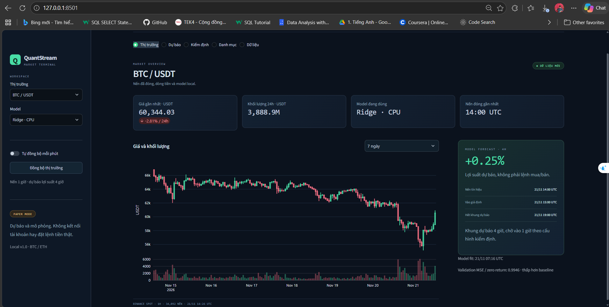

*Hình 18 — Trang Thị trường: giá hiển thị 60.344,03 USDT, khối lượng 24 giờ 3.888,9 triệu USDT và dự báo return +0,25%. Tín hiệu mang mốc 21/11/2026 14:00 UTC, thời điểm vào giả định 15:00 và hết horizon 19:00 UTC. Đây là trạng thái hiển thị tại lúc chụp, không phải kết quả dự báo đã được xác nhận.*

### Lịch sử forecast và đóng góp feature

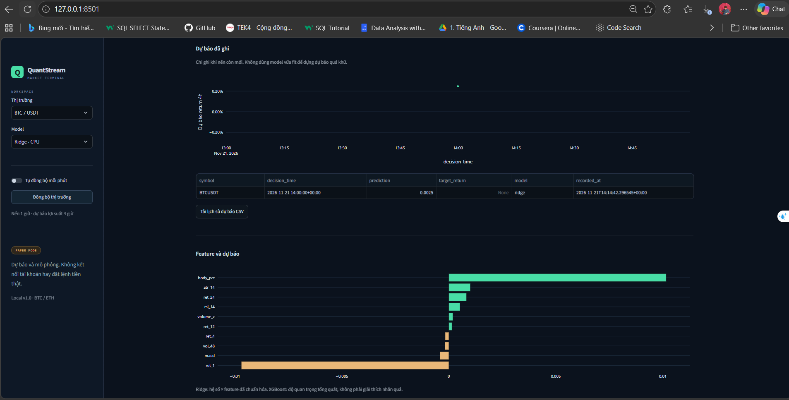

*Hình 19 — Trang Dự báo có một forecast BTCUSDT lúc 14:00 UTC, giá trị 0,0025 tương ứng +0,25%. `target_return` đang là `None`, nên chưa thể chấm sai số cho dự báo này. Phần dưới hiển thị hệ số Ridge nhân với feature đã chuẩn hóa; biểu đồ không diễn giải quan hệ nhân quả.*

### Kiểm định và baseline

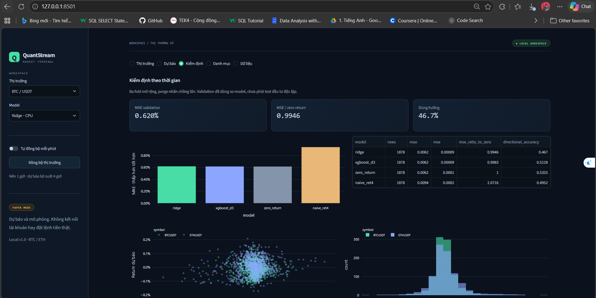

*Hình 20 — App hiển thị MAE validation 0,620%, MSE/zero-return 0,9946 và directional accuracy 46,7% của Ridge. Bảng so sánh gồm Ridge, XGBoost, zero-return và naive return trên 1.878 mẫu; phía dưới là dự báo so với nhãn và phân phối sai số. Các metric này là validation lịch sử, không phải kết quả của forecast mới ở Hình 19.*

### Mô phỏng trên validation

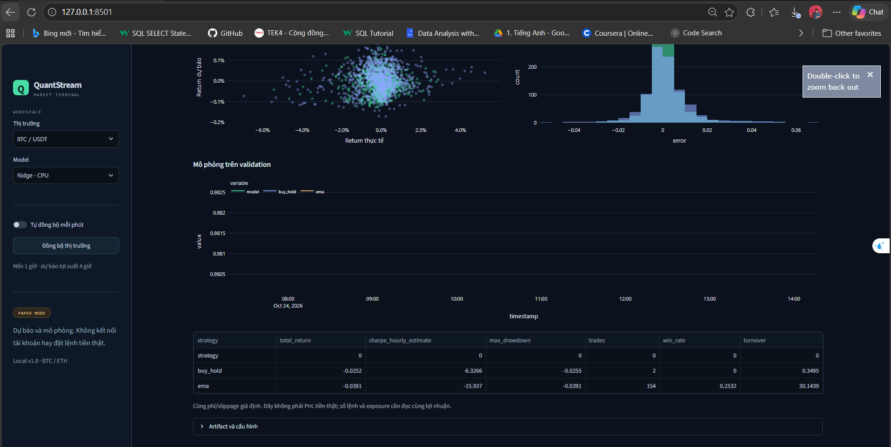

*Hình 21 — Bảng backtest ghi Ridge có 0 lệnh và return bằng 0; buy-and-hold khoảng −2,52%, EMA khoảng −3,91% sau các giả định chi phí. Ảnh đang giữ trạng thái zoom của Plotly, nên vùng hiển thị không chứa đầy đủ đường equity. Biểu đồ toàn kỳ được trình bày tại Hình 16; không dùng vùng trống trong ảnh này để đánh giá lợi nhuận.*

### Danh mục paper

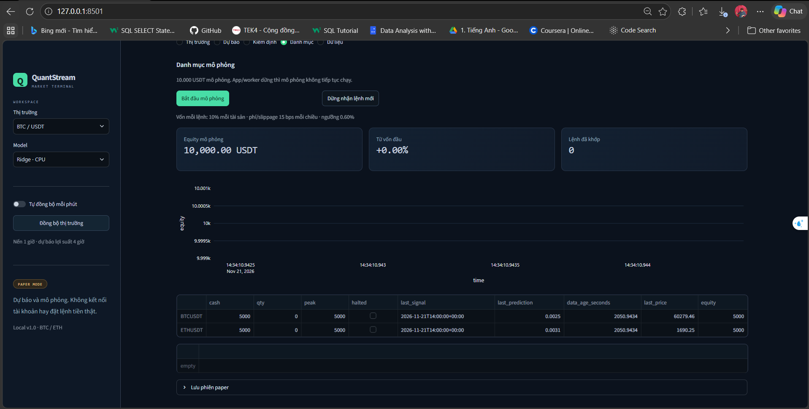

*Hình 22 — Trang Danh mục hiển thị vốn giả lập 10.000 USDT, thay đổi +0,00% và 0 lệnh đã khớp. Mỗi tài sản đang có 5.000 USDT tiền mặt, số lượng nắm giữ bằng 0. Cấu hình trên ảnh là 10% vốn mỗi tài sản, phí/slippage 15 bps mỗi chiều và ngưỡng 0,60%. Đây là trạng thái phiên paper tại lúc chụp, chưa chứng minh hiệu quả giao dịch.*

### Dữ liệu và vận hành

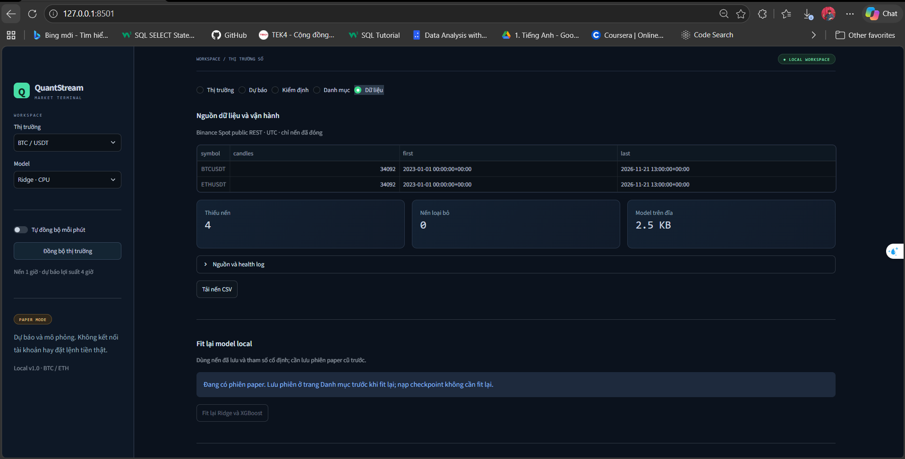

*Hình 23 — Trang Dữ liệu ghi 34.092 nến cho mỗi tài sản, từ 01/01/2023 đến nến mở 21/11/2026 13:00 UTC, tổng cộng 68.184 nến. App ghi 4 nến thiếu, 0 nến bị loại và file Ridge khoảng 2,5 KB. Thao tác fit lại đang bị khóa vì có phiên paper; cần lưu phiên trước khi đổi model.*

Dữ liệu vận hành trong bộ ảnh đã có phạm vi dài hơn snapshot **67.820 nến** dùng để chạy notebook ở mục 4. Vì vậy số nến trên app và số nến trong báo cáo nghiên cứu khác nhau. Đồng bộ nến không tự huấn luyện lại model và không biến validation lịch sử thành một test độc lập mới.

Notebook 04 đã dùng Streamlit AppTest kiểm tra runtime của năm trang. Bộ screenshot bổ sung bằng chứng giao diện trên trình duyệt Windows; không thay cho metric, logs hoặc kiểm thử. Tên file, kích thước và SHA256 của sáu ảnh được ghi trong [screenshots.json](reports/app/screenshots.json). Khi chụp bổ sung, giữ nguyên tên model, thời điểm dữ liệu, đơn vị và các trạng thái như chưa đủ nhãn hoặc 0 lệnh.

## 12. Công nghệ sử dụng

| Nhóm | Công nghệ | Vai trò |
|---|---|---|
| Ngôn ngữ và môi trường | Python 3.12, venv | Code xử lý, train, serving và môi trường local |
| Dữ liệu | pandas, NumPy, PyArrow/Parquet, DuckDB | Tính toán, lưu bảng, truy vấn và kiểm tra |
| Nguồn dữ liệu | Binance archives, REST, WebSocket | Dữ liệu thị trường công khai |
| ML truyền thống | scikit-learn, XGBoost | Pipeline chuẩn hóa, Ridge và boosted trees |
| Deep learning | PyTorch | TCN, optimizer, loss, checkpoint và inference CPU |
| Nghiên cứu mở rộng | Optuna; mô-đun time series pretrained tùy chọn | Các protocol thử nghiệm riêng, không bắt buộc để chạy app core |
| Notebook và biểu đồ | Jupyter/IPython, nbformat, Matplotlib, Graphviz | Chạy nghiên cứu, lưu output và xuất ảnh có nguồn |
| Ứng dụng | Streamlit, Plotly | Giao diện local và biểu đồ tương tác |
| Trạng thái và vận hành | SQLite, file locks, JSON metadata | Forecast history, registry, paper state và chống ghi đồng thời |
| Kiểm thử và quản lý mã | Pytest, Ruff, Git, GitHub Actions | Kiểm tra chất lượng và CI đa nền tảng |

Phiên bản thực tế của lượt notebook nằm trong [execution.json](reports/final_study/execution.json). `pyproject.toml` định nghĩa dependencies; `requirements-tested-core.txt` ghi các phiên bản core đã dùng. CUDA không bắt buộc cho app hoặc bốn notebook này.

## 13. Cài đặt và chạy ứng dụng

### Windows PowerShell

Chạy lệnh từ thư mục dự án đang có `app.py` và `pyproject.toml`. Không cần tải lại repository nếu đã có code.

```powershell
py -3.12 -m venv .venv
.\.venv\Scripts\python.exe -m pip install -e . -c requirements-tested-core.txt
```

Nếu `.venv` đã tồn tại, dùng Python trong môi trường đó và bỏ lệnh tạo môi trường mới. Không bắt buộc activate để chạy các lệnh bên dưới.

**Workspace mới:** khởi tạo dữ liệu gần nhất và baseline local:

```powershell
.\.venv\Scripts\python.exe -m quantstream.terminal --root workspace setup --days 90
```

Nếu đã có `workspace/artifacts/local_registry.json`, bỏ qua `setup`. Lệnh này chủ động từ chối khi đã có model. Dữ liệu 90 ngày khởi tạo khác snapshot dài dùng cho bảng kết quả ở README.

Mở app:

```powershell
.\.venv\Scripts\python.exe -m streamlit run app.py --server.address 127.0.0.1 --server.port 8501
```

Truy cập [http://127.0.0.1:8501/](http://127.0.0.1:8501/). Để dùng workspace do notebook vừa tạo:

```powershell
$env:QUANTSTREAM_ROOT = "$PWD\notebook_work\final_study"
.\.venv\Scripts\python.exe -m streamlit run app.py --server.address 127.0.0.1 --server.port 8501
```

### Linux

```bash
python3.12 -m venv .venv
.venv/bin/python -m pip install -e . -c requirements-tested-core.txt
.venv/bin/python -m quantstream.terminal --root workspace setup --days 90
.venv/bin/python -m streamlit run app.py --server.address 127.0.0.1 --server.port 8501
```

`setup` chỉ dùng cho workspace mới. Chọn bộ nghiên cứu bằng `QUANTSTREAM_ROOT=notebook_work/final_study` trước lệnh Streamlit nếu muốn xem kết quả notebook.

### Đồng bộ, import và lưu phiên

Đồng bộ một lượt hoặc chạy worker liên tục:

```powershell
.\.venv\Scripts\python.exe -m quantstream.terminal --root workspace refresh
.\.venv\Scripts\python.exe -m quantstream.terminal --root workspace watch
```

Chạy một worker cho mỗi workspace. App/worker dùng file lock; máy ngủ hoặc tiến trình dừng thì hệ thống không chạy liên tục. Nạp thêm nến không tự cập nhật weights.

Nạp gói lịch sử đã có `bars.parquet` và `history_manifest.json`:

```powershell
.\.venv\Scripts\python.exe -m quantstream.history_import --root workspace --archive "D:\du-lieu\QuantStream_Training_History.zip"
```

Fit lại Ridge/XGBoost trong trang **Dữ liệu**. Nếu có phiên paper đang hoạt động, chờ vị thế đóng rồi lưu phiên trước khi đổi model:

```powershell
.\.venv\Scripts\python.exe -m quantstream.terminal --root workspace archive-paper
```

Không xóa state để bỏ guard. Với bundle portable từ các vòng nghiên cứu cũ, dùng `import-model --folder <thu-muc-bundle>`. Với TCN có đúng manifest/holdout contract, cài phần `dl` rồi dùng `import-tcn`; TCN refit trong bốn notebook hiện tại không thuộc loại bundle đó.

### Một số lỗi thường gặp

| Hiện tượng | Cách kiểm tra |
|---|---|
| `origin` chưa được cấu hình | Kiểm tra `git remote -v`; thêm đúng URL repository trước khi `git pull` |
| Bị chặn refit vì paper | Lưu phiên đúng quy trình, chờ hết vị thế mở |
| Manifest/model không khớp SHA | Dùng đúng cặp dữ liệu/artifact; không sửa hash để bỏ kiểm tra |
| App dùng sai workspace | Kiểm tra biến `QUANTSTREAM_ROOT` và khởi động lại tiến trình |
| Không tải được nến | Kiểm tra HTTP error và health; vẫn có thể mở dữ liệu đã lưu |
| Port 8501 đang dùng | Dừng app cũ hoặc dùng `--server.port 8502` |
| Notebook thiếu input | Kiểm tra snapshot và biến `QUANTSTREAM_HISTORY_DIR` |
| Số liệu khác README | Đối chiếu snapshot, kỳ dữ liệu, horizon, config và phiên bản thư viện |

Dừng app/worker rồi sao lưu toàn bộ workspace để giữ nến, models, registry, SQLite forecast và phiên paper. Các file vận hành và weights không được đưa vào Git.

## 14. Chạy lại toàn bộ notebook

Repository chỉ giữ **4 notebook đang sử dụng**, đọc theo thứ tự:

| Notebook | Nội dung và đầu ra |
|---|---|
| [01_Data](notebooks/01_Data.ipynb) | Kiểm tra snapshot, chất lượng, features, nhãn, chuẩn hóa, split và sơ đồ |
| [02_Training](notebooks/02_Training.ipynb) | Inner parameter study, fit Ridge/XGBoost/TCN, loss logs, weights và importance |
| [03_Evaluation](notebooks/03_Evaluation.ipynb) | Chung cohort, baseline, từng fold, sai số, chuỗi forecast và backtest sau phí |
| [04_Inference](notebooks/04_Inference.ipynb) | Reload/hash/parity, dự đoán từ artifact, AppTest 5 trang và gói workspace |

Bản trong Git đã có output của một lượt chạy hoàn chỉnh. Các notebook Kaggle/LoRA cũ đã được bỏ khỏi cây hiện tại; vẫn có thể đọc [bản lịch sử tại commit 3178956](https://github.com/taiiswibu/quantstream-crypto-research/tree/317895640d259da580eeeafb4ce6dd273246741a/notebooks). Chúng không được tính là đã chạy lại trong lượt CPU này.

### Chuẩn bị dữ liệu

Đặt hai file `bars.parquet` và `history_manifest.json` vào `research_input/`, hoặc trỏ tới thư mục snapshot đã giải nén:

```powershell
$env:QUANTSTREAM_HISTORY_DIR = "D:\du-lieu\quantstream-history"
```

Không phải file `source_manifest.json` cũ nào cũng thay thế được `history_manifest.json`: SHA256 phải khớp đúng `bars.parquet` và metadata số dòng phải đúng. Raw snapshot không được commit vào repo. Gói workspace ở mục 10 chứa sẵn cặp file này trong `data/processed/`; có thể trỏ biến môi trường vào thư mục đó để chạy lại. Với dữ liệu khác, cần chuẩn bị manifest tương ứng và ghi kết quả thành một lượt riêng.

Pipeline archive của CLI sử dụng `config.json` và có thể chạy bằng `python -m quantstream download` tại root dự án. Lệnh đó có truy cập mạng và tải lịch sử theo cấu hình; bộ bốn notebook không tự tải lại toàn bộ dữ liệu mỗi lần rerun.

### Cài phần nghiên cứu và thực thi

```powershell
.\.venv\Scripts\python.exe -m pip install torch --index-url https://download.pytorch.org/whl/cpu
.\.venv\Scripts\python.exe -m pip install -e ".[dev,notebook,dl]" -c requirements-tested-core.txt
.\.venv\Scripts\python.exe scripts/run_notebooks.py
```

Cần cài **Graphviz** và kiểm tra `dot -V` chạy được trong terminal. Có thể mở từng notebook bằng kernel `.venv` trong VSCode/Jupyter rồi Run All theo thứ tự 01 → 04.

Runner tự chạy mỗi notebook trong một tiến trình IPython mới, theo thứ tự cell, ghi stdout/stderr và rich output. Không bỏ qua cell train hoặc thay bằng ảnh có sẵn. Có lỗi thì dừng; metadata chỉ ghi `completed=true` sau khi toàn bộ cell thành công. Lượt này dùng engine IPython in-process, không phải remote Kaggle kernel.

Mặc định model được lưu ở `notebook_work/final_study`. Chạy lại từ đầu trên cùng thư mục đã có registry sẽ bị chặn để tránh ghi đè. Chọn một thư mục mới trước khi chạy:

```powershell
$env:QUANTSTREAM_STUDY_ROOT = "$PWD\notebook_work\study_02"
.\.venv\Scripts\python.exe scripts/run_notebooks.py
```

Bảng/ảnh trong `reports/final_study` và output notebook sẽ được cập nhật theo lượt mới. Muốn giữ nguyên bản công bố thì chạy trên branch/thư mục riêng. Thời gian chạy phụ thuộc CPU, thư viện và dữ liệu; sáu epoch TCN là ngân sách cố định, không có cam kết rằng phải train lâu mới đạt chất lượng.

### Nguồn của ảnh minh chứng

Có **17 ảnh từ output notebook** trong [reports/final_study/figures](reports/final_study/figures), tương ứng Hình 1–17. Sáu screenshot app tại Hình 18–23 được lưu riêng trong [reports/app](reports/app), có manifest nguồn và SHA256. Runner xuất nguyên byte PNG từ notebook và tạo bốn manifest ảnh, ghi notebook SHA256, cell index, execution count và image SHA256.

Có thể xuất lại ảnh một notebook:

```powershell
.\.venv\Scripts\python.exe scripts/export_notebook_images.py notebooks/03_Evaluation.ipynb --output reports/final_study/figures
```

Không dùng ảnh tạo sinh để thay biểu đồ, không dựng loss giả cho Ridge và không gọi output notebook là screenshot ứng dụng live.

## 15. Cấu trúc repository và kiểm thử

README này là tài liệu giới thiệu, báo cáo kết quả và hướng dẫn vận hành duy nhất ở phiên bản hiện tại. License được giữ riêng; attribution của nguồn ngoài được gộp ở mục 17. Các tài liệu lặp, launcher `.cmd/.bat/.sh`, generator notebook cũ và notebook trùng đã được dọn khỏi cây đang dùng.

| Đường dẫn | Nội dung |
|---|---|
| `app.py`, `quantstream/` | Ứng dụng, dữ liệu, features, train/inference, backtest và paper |
| `notebooks/` | Bốn notebook có kết quả thực thi |
| `scripts/final_study.py` | Các phép tính dùng chung, huấn luyện và dựng biểu đồ |
| `scripts/run_notebooks.py` | Chạy đủ bốn notebook trong các tiến trình riêng |
| `scripts/export_notebook_images.py` | Xuất ảnh nguyên byte và manifest nguồn |
| `scripts/modern_studies/` | Các extension nghiên cứu tùy chọn, không nằm trong lượt CPU này |
| `tests/`, `.github/workflows/` | Kiểm thử dữ liệu, mô hình, accounting, import, UI và CI |
| `reports/final_study/` | Bảng số liệu, logs, provenance và ảnh của lượt hiện tại |
| `reports/experiments/`, `reports/reference/` | Bằng chứng các vòng nghiên cứu cũ và protocols tham chiếu |
| `reports/diagrams/` | Mã nguồn sơ đồ hệ thống, target và TCN |
| `reports/app/` | Sáu ảnh chụp app thực tế và manifest nguồn ảnh |
| `research_input/` | Snapshot đầu vào ở máy người chạy; không commit |
| `notebook_work/`, `workspace/` | Dữ liệu và artifact phát sinh; không commit |

Git history và số liệu thí nghiệm được giữ nguyên để có thể truy nguyên. Dọn tài liệu không làm các lần thử không đạt biến mất khỏi kết quả nghiên cứu.

Chạy kiểm tra:

```powershell
.\.venv\Scripts\python.exe -m pip install -e ".[dev]"
.\.venv\Scripts\python.exe -m ruff check quantstream app.py tests scripts
.\.venv\Scripts\python.exe -m pytest -q
.\.venv\Scripts\python.exe scripts/check_notebooks.py
.\.venv\Scripts\python.exe -m compileall -q quantstream app.py scripts
```

CI chạy trên Linux/Windows. Test tập trung vào tính nhân quả của features, purge nhãn, nến/gap, accounting và chi phí, model/hash/config contract, import và paper state. Kết quả kiểm tra local: **105 tests đạt**, Ruff, compile và schema của cả bốn notebook đều đạt; xem [software_checks.json](reports/final_study/software_checks.json). Kiểm tra schema notebook chỉ xác minh cấu trúc/cú pháp; output có execution metadata và manifest ảnh mới là bản ghi của lượt thực thi.

## 16. Kinh nghiệm và hướng phát triển

### Những kỹ năng thực hành từ dự án

| Mảng | Nội dung đã thực hành |
|---|---|
| Data Engineering | Tích hợp archive/API/stream; chuẩn hóa schema và UTC; Parquet; kiểm tra chất lượng và nguồn dữ liệu |
| Machine Learning | Feature engineering chuỗi thời gian, scaler fit train, baseline, regularization, boosted trees, TCN và logs optimizer |
| Nghiên cứu thực nghiệm | Tách train/validation theo thời gian, purge nhãn, so cùng cohort, đọc kết quả thất bại và giới hạn thống kê |
| Triển khai ML | Lưu/nạp artifact, hash/config contract, inference CPU, registry và kiểm tra parity |
| Ứng dụng dữ liệu | Streamlit/Plotly, hiển thị độ mới dữ liệu, forecast history và mô phỏng danh mục |
| Kỹ thuật phần mềm | Module hóa, file locking, kiểm thử, CI đa nền tảng và báo cáo có minh chứng |

Bài học chính là một pipeline chạy được và một model tạo ra lợi thế dự báo là hai mức hoàn thành khác nhau. Dự án đã triển khai được luồng kỹ thuật; phần chất lượng tín hiệu vẫn cần nghiên cứu tiếp dựa trên bằng chứng.

### Điều gì cần cải thiện?

Hiện chưa đủ bằng chứng để kết luận riêng dữ liệu lỗi, thuật toán yếu hay train quá ít là nguyên nhân duy nhất. Snapshot đã qua kiểm tra kỹ thuật nhưng OHLCV 1H có thể vẫn thiếu tín hiệu cho nhãn đang chọn. Dự báo gần 0 cũng có thể là hệ quả của regularization và mục tiêu MSE trong thị trường nhiều nhiễu. Đây là giả thuyết cần kiểm chứng, không phải kết luận từ một hình.

Hướng tiếp theo theo thứ tự ưu tiên:

1. **Đóng băng protocol và chờ dữ liệu tương lai mới.** Xác định trước metric, thời gian và tiêu chí chấp nhận. Không tiếp tục điều chỉnh trên cùng một kỳ rồi gọi kỳ đó là test độc lập.
2. **Kiểm tra sự khác biệt theo giai đoạn và tài sản.** Báo cáo từng fold, thị trường tăng/giảm và volatility regime; dùng phương pháp có xét phụ thuộc thời gian khi so sai số.
3. **Ablation dữ liệu và target.** So nhóm OHLCV với dữ liệu bổ sung như funding/basis nếu thu thập được đúng lịch công bố; kiểm tra horizon và đơn vị nhãn. Dữ liệu bổ sung phải có timestamp khả dụng, không chỉ timestamp sự kiện.
4. **Tuning có ngân sách và nhiều seed.** Dùng inner temporal validation trước outer evaluation; kiểm tra độ ổn định thay vì chọn duy nhất seed tốt nhất. Với TCN cần xem cả receptive field, learning rate, loss và mức regularization.
5. **Theo dõi vận hành.** Forecast thật có thời điểm phát hành, chấm khi nhãn hoàn tất, theo dõi độ mới dữ liệu và drift. Chỉ bàn nâng cấp triển khai sau khi có bằng chứng ngoài mẫu và sau phí.

Không có cam kết rằng thay model lớn hơn, thêm dữ liệu bất kỳ hay tăng epoch sẽ tự tạo ra lợi nhuận. Điều kiện để đi tiếp là một cải thiện đo được, ổn định và kiểm tra lại được.

## 17. Nguồn dữ liệu và bản quyền

Mã ứng dụng QuantStream theo [MIT License](LICENSE). Quyền sử dụng dữ liệu, pretrained weights và dependencies không được thay thế bởi license của mã ứng dụng.

- **Binance Spot market data:** lấy từ public archives/API. Các URL archive và checksum lịch sử được ghi trong [source_manifest.json](reports/reference/source_manifest.json); snapshot đang dùng có hash riêng ở mục 4. Điều khoản: [Binance public data terms](https://github.com/binance/binance-public-data/blob/master/TERMS_AND_CONDITIONS.md).
- **FraudGuard của ItsLewis-DE:** tham khảo ý tưởng kiến trúc tại commit `5144d6d63dc38b4af0e0a68fd8638f369d35a7a4`; không đóng gói source code của repository đó.
- **Chronos-2 của Amazon:** model/library theo Apache-2.0; [source](https://github.com/amazon-science/chronos-forecasting), [model](https://huggingface.co/amazon/chronos-2). Các vòng fine-tuning lịch sử dùng adapter với base model riêng; revision/provenance nằm trong report của từng vòng. Bốn notebook hiện tại không tải weights hay chạy lại fine-tuning Chronos.
- **Thư viện:** PyTorch, scikit-learn, XGBoost, pandas, NumPy, PyArrow, DuckDB, Streamlit, Plotly, Transformers, PEFT và các dependencies giữ license của từng bên. Chúng được cài qua package manager, không đóng gói bản phân phối thư viện trong repository.

Các thí nghiệm và protocol cũ có thể đối chiếu trong [bản tài liệu lịch sử](https://github.com/taiiswibu/quantstream-crypto-research/tree/317895640d259da580eeeafb4ce6dd273246741a/docs/experiments) và các báo cáo máy đọc được còn trong `reports/`. Hình 1–17 là biểu đồ/diagram từ notebook đã chạy; Hình 18–23 là ảnh chụp app local do người dùng cung cấp, giữ nguyên số liệu và trạng thái hiển thị.
