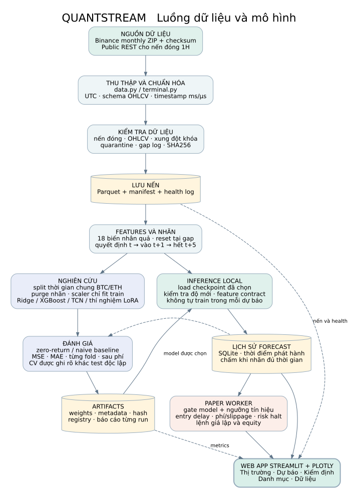
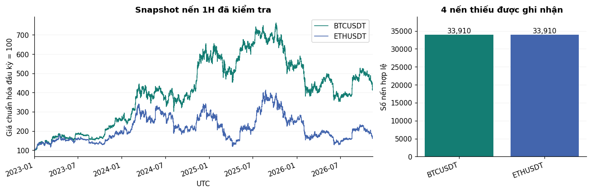
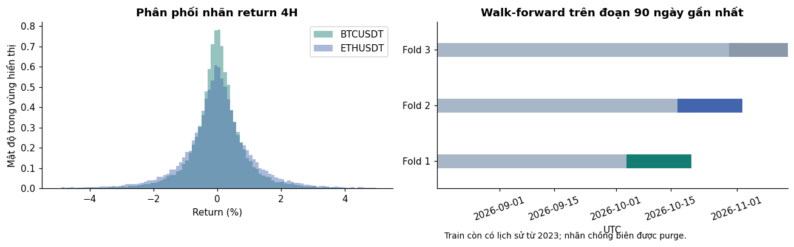
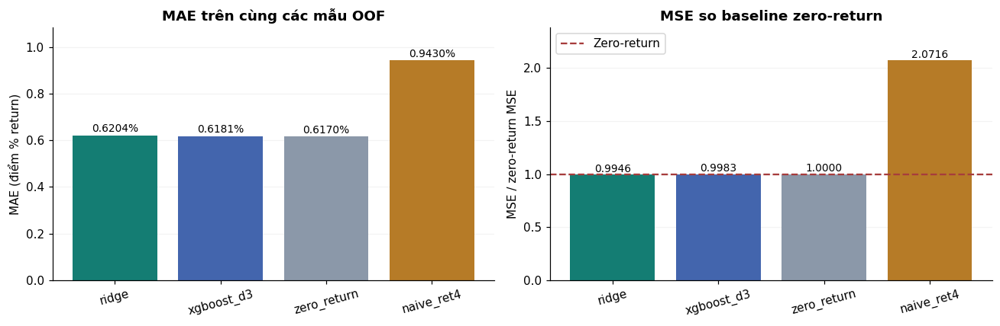
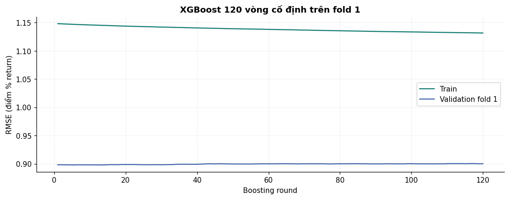
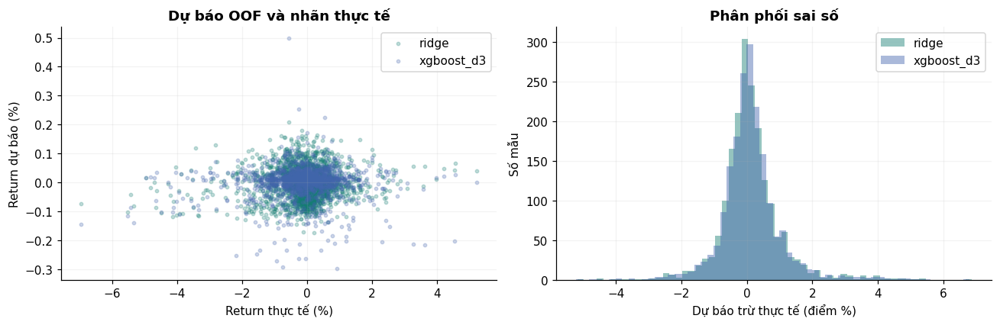
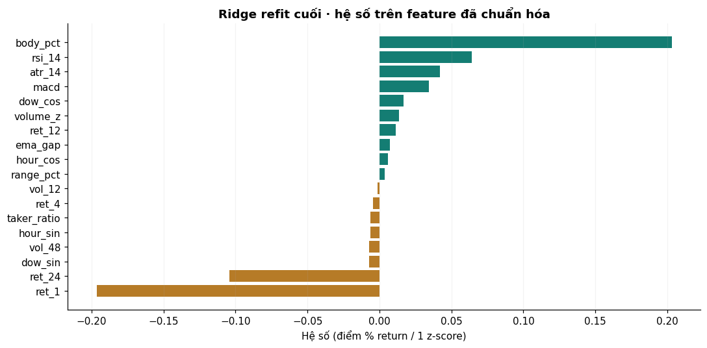
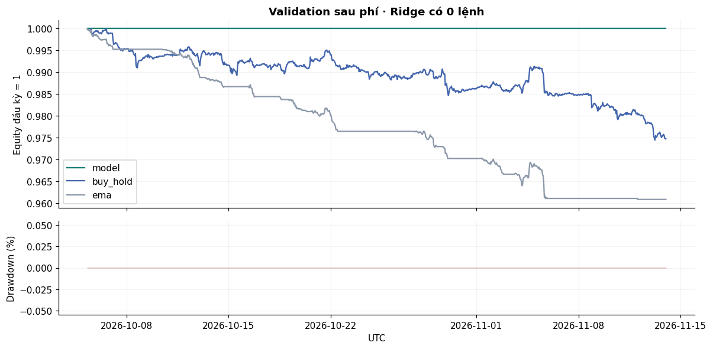
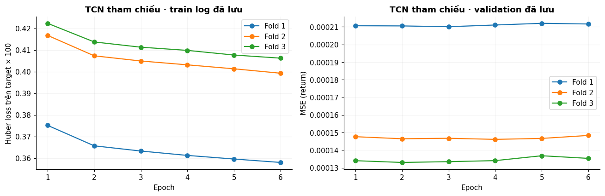
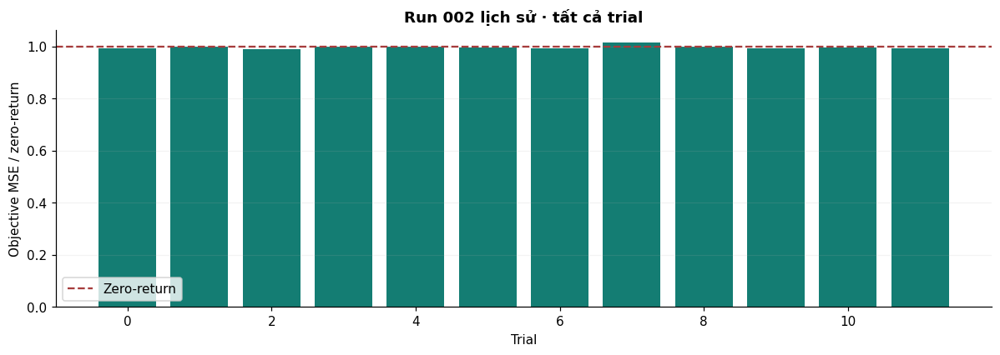

# QuantStream

[](https://github.com/taiiswibu/quantstream-crypto-research/actions/workflows/ci.yml)

**Pipeline dữ liệu thị trường, nghiên cứu dự báo và ứng dụng theo dõi local cho BTC/USDT và ETH/USDT.**

QuantStream thu thập nến Binance, kiểm tra chất lượng dữ liệu, tạo features nhân quả, huấn luyện model và đưa dự báo lên web app. Kết quả được đối chiếu với baseline và mô phỏng sau phí. Dự án giữ checkpoint, metadata, notebook đã chạy và ảnh minh chứng để có thể kiểm tra lại từng phần.

[Báo cáo dự án chi tiết](docs/BAO_CAO_DU_AN_VI.md) · [Notebook minh chứng đã chạy](notebooks/13_Project_Evidence_VI.ipynb) · [Cài đặt và vận hành](docs/VAN_HANH_VI.md)

## Dự án đã làm được gì

| Hạng mục | Kết quả triển khai |
|---|---|
| Dữ liệu | Snapshot 67.820 nến 1H của BTC/ETH, nguồn Binance archive và REST |
| Chất lượng | Kiểm tra SHA, UTC, OHLCV, nến đóng, khóa trùng/xung đột, quarantine và gap |
| Features | 18 biến từ return, biến động, xu hướng, volume, hình dạng nến và chu kỳ thời gian |
| Machine learning | Ridge, XGBoost và các thí nghiệm TCN/GRU/Chronos-2 LoRA có hồ sơ riêng |
| Kiểm định | Ba fold thời gian có purge; baseline zero-return và naive; báo cáo OOF |
| Backtest | Long/cash, vào trễ, phí/slippage, horizon, exposure và drawdown |
| Triển khai local | Streamlit + Plotly, inference CPU, registry/checkpoint, lịch sử forecast và paper |
| Tái lập | Input/model/code hash, config, notebook output, manifest ảnh và CI Linux/Windows |

Stack: **Python · pandas · NumPy · Parquet/PyArrow · DuckDB · scikit-learn · XGBoost · PyTorch · Optuna · Streamlit · Plotly · SQLite · GitHub Actions**.

Phạm vi hiện tại là ứng dụng nghiên cứu chạy local. Model còn yếu về dự báo; kết quả chưa đủ để dùng vốn thật.

## Từ dữ liệu thị trường đến dự báo



[Sơ đồ PNG từ output notebook](reports/portfolio_cpu/figures/13_Project_Evidence_VI-01-system-1.png) · [Mã sơ đồ](docs/architecture.dot)

Dữ liệu đi từ archive/REST qua kiểm tra chất lượng đến Parquet. `features.py` dùng chung cách tính cho nghiên cứu và inference. Nhánh nghiên cứu tạo model/báo cáo; nhánh runtime nạp model đã chọn, ghi forecast và theo dõi danh mục paper. Không có kết nối đặt lệnh tiền thật.

Model dự báo **return 4 giờ sau 1 giờ chờ thực thi**. Quyết định lúc 16:00 UTC tương ứng vào giả định 17:00 và hết horizon 21:00. Nến mở 15:00 chỉ trở nên quan sát được khi đóng lúc 16:00. Các ranh giới train/validation dùng thời điểm nhãn đầy đủ để tránh look-ahead.

## 1. Thu thập dữ liệu và kiểm tra chất lượng

[Notebook 13](notebooks/13_Project_Evidence_VI.ipynb) đã chạy kiểm tra snapshot, tiền xử lý, train CPU, baseline, đường học và backtest. [Notebook 08](notebooks/08_Local_Model_Review.ipynb) đọc lại các artifacts vừa tạo để review.

Snapshot có 33.910 nến mỗi tài sản, từ 01/01/2023 đến 13/11/2026 UTC. Bốn nến thiếu được ghi nhận; chỉ báo được reset tại gap. Lượt minh chứng dùng dữ liệu đã lưu và đối chiếu SHA, không tải lại toàn bộ nguồn trong lần chạy này.



### 2. Tạo nhãn và chia tập theo thời gian

Model cần phân biệt lúc nến đóng với lúc nhãn tương lai đã đầy đủ. Mỗi fold dùng cùng ranh giới UTC cho BTC/ETH và purge những nhãn chồng qua ranh giới.



Các ảnh được trích nguyên byte từ output notebook. [Manifest ảnh Notebook 13](reports/portfolio_cpu/figures/13_Project_Evidence_VI-images.json) và [Notebook 08](reports/portfolio_cpu/figures/08_Local_Model_Review-images.json) ghi notebook hash, cell, execution count và image hash. Đây là ảnh kết quả tính toán, không phải ảnh chụp app Windows hoặc một lượt Kaggle mới.

## 3. Huấn luyện model và so sánh baseline

Lượt notebook ngày 21/11/2026 theo giờ Việt Nam fit model cuối trên **67.608 mẫu có nhãn**. Ba fold tạo **1.878 mẫu OOF/model**, gồm 939 BTC và 939 ETH. Kỳ validation bắt đầu **05/10/2026 07:00 UTC**, nhãn cuối kết thúc **14/11/2026 00:00 UTC**.

| Model | MAE return | MSE / zero-return | Đúng hướng |
|---|---:|---:|---:|
| Ridge | 0,6204% | **0,994550** | 46,70% |
| XGBoost | 0,6181% | **0,998255** | 51,28% |
| Zero-return | **0,6170%** | 1,000000 | 53,25% |
| Naive return 4H trước đó | 0,9430% | 2,071623 | 49,52% |



Ridge giảm MSE khoảng 0,545% so với zero-return, nhưng MAE của cả Ridge/XGBoost vẫn kém baseline này. Ridge thua MSE ở một fold; XGBoost thua ở hai fold. Validation đã dùng để quan sát/so model, chưa phải một final test độc lập mới. DA dùng quy ước `return > 0`; dự báo 0 thuộc nhóm không tăng.

[Metrics CSV](reports/portfolio_cpu/validation_metrics.csv) · [Từng fold](reports/portfolio_cpu/fold_metrics.csv) · [Execution record và hashes](reports/portfolio_cpu/execution.json)



Đường học là một lượt fit chẩn đoán fold 1 với 120 boosting rounds cố định. Log TCN và 12 trial tuning lịch sử được trình bày riêng trong báo cáo; không được gọi là lượt train GPU mới của bộ hồ sơ này.

### 4. Dự báo thực tế và phân phối sai số



Các điểm được tạo bằng model của từng fold, trước bước refit cuối. Dự báo tập trung gần 0 trong khi return thực tế có đuôi lớn hơn. Đây là giới hạn thấy được trên dữ liệu, không phải bằng chứng chỉ cần tăng biên độ forecast để sửa model.

### 5. Đọc model qua features



Ridge cho phép xem hệ số theo một đơn vị z-score của feature. Biểu đồ giúp kiểm tra dấu và độ lớn hệ số; quan hệ này không phải giải thích nhân quả cho giá thị trường. XGBoost là mô hình cây và không có hàm kích hoạt neural.

### 6. Mô phỏng sau chi phí giao dịch



Cấu hình local dùng phí 10 bps + slippage 5 bps mỗi chiều, ngưỡng long 0,60% và position fraction 10%. Ridge có 0 lệnh ở kỳ này. Vì vậy đường equity phẳng không chứng minh model sinh lời hoặc quản lý rủi ro tốt hơn một chiến lược đã có exposure.

### 7. TCN và lịch sử điều chỉnh siêu tham số



TCN tham chiếu dùng causal convolutions với dilation 1/2/4/8, GELU và residual connections. Log bên trên thuộc artifact lịch sử; train loss giảm không đi kèm cải thiện validation đều qua các epoch. Bộ hồ sơ này vẽ lại log, không tuyên bố có lượt train TCN/GPU mới.



Giữ toàn bộ trial để nhìn thấy cả cấu hình không vượt zero-return. Kỳ dữ liệu và ngân sách của Run 002 khác lượt CPU hiện tại, nên không trộn các objective vào bảng so sánh cùng cohort ở trên.

Audit local ngày 20/11 dùng cohort khác dù cũng có 1.878 mẫu/model. Kết quả Ridge 0,9961 và XGBoost 0,9991 của audit được giữ trong [báo cáo riêng](docs/experiments/local-validation-20261120.md), không lấy chênh lệch hai kỳ làm mức cải thiện.

## 8. Ứng dụng local và ảnh giao diện

| Trang | Chức năng |
|---|---|
| Thị trường | Giá/ticker, nến, volume và thời điểm dự báo |
| Dự báo | Forecast đã ghi, feature và khoảng tham chiếu |
| Kiểm định | Baseline, lỗi dự báo, từng fold, mô phỏng và checkpoint |
| Danh mục | Vốn giả lập, lệnh, equity và quản lý phiên paper |
| Dữ liệu | Nguồn, health, hash, nạp lịch sử, fit và import model |

Giá hiện tại, validation và forecast sau triển khai có vai trò khác nhau. Hệ thống lưu thời điểm phát hành forecast rồi chấm khi nhãn đã đầy đủ; không tạo lịch sử dự báo quá khứ bằng weights fit sau đó. Phiên paper phải được lưu đúng luồng trước khi đổi model/refit.

### Cách chụp ảnh app để bổ sung vào hồ sơ

Chụp riêng năm trang **Thị trường, Dự báo, Kiểm định, Danh mục, Dữ liệu**. Giữ tên model, tài sản, thời gian nến và đơn vị biểu đồ trong khung; ở trang Kiểm định chụp cả baseline và từng fold. Lưu PNG vào `reports/app/` theo [checklist chụp ảnh](docs/VAN_HANH_VI.md#chụp-ảnh-giao-diện-làm-minh-chứng). Chỉ đưa ảnh app thật vào phần này sau khi đã chụp; 15 ảnh notebook được lưu riêng với manifest nguồn.

### Chạy trên Windows khi đã có code

Cần Python 3.12 64-bit. Nếu chưa có môi trường ảo, tạo bằng `py -3.12 -m venv .venv`. Sau đó chạy tại thư mục dự án:

```powershell
.\.venv\Scripts\python.exe -m pip install -e . -c requirements-tested-core.txt
.\.venv\Scripts\python.exe -m streamlit run app.py --server.address 127.0.0.1 --server.port 8501
```

Mở [http://127.0.0.1:8501/](http://127.0.0.1:8501/). Không cần clone lại nếu đã có code.

Nếu workspace hoàn toàn mới, khởi tạo 90 ngày dữ liệu và model CPU trước khi mở app:

```powershell
.\.venv\Scripts\python.exe -m quantstream.terminal --root workspace setup --days 90
```

Lệnh setup từ chối khi model đã tồn tại. Dữ liệu 90 ngày khởi tạo không phải snapshot đầy đủ dùng trong bảng minh chứng. [Hướng dẫn Linux, worker, import model, notebook và sao lưu](docs/VAN_HANH_VI.md).

## Cấu trúc repo

| Thư mục | Nội dung |
|---|---|
| `quantstream/` | Ingestion, features, model, backtest, runtime và UI |
| `notebooks/` | Notebook nghiên cứu và notebook đã chạy phục vụ hồ sơ |
| `reports/portfolio_cpu/` | Metrics, log, hashes và ảnh của lượt CPU minh chứng |
| `reports/reference/`, `reports/experiments/` | Bằng chứng của các thí nghiệm lịch sử |
| `docs/` | Báo cáo dự án, vận hành, nguồn và hồ sơ thí nghiệm |
| `scripts/` | Công cụ nghiên cứu, dựng notebook, xuất ảnh và kiểm tra |
| `tests/` | Kiểm tra nhân quả, chi phí, artifact, snapshot và runtime |

Nến gốc, weights, SQLite, optimizer state và phiên paper giữ ngoài Git. `workspace/` là dữ liệu app; `notebook_work/` là vùng nghiên cứu riêng.

## Kiểm thử

```bash
python -m pip install -e ".[dev]" -c requirements-tested-core.txt
python -m pytest -q
python -m ruff check quantstream app.py tests scripts
python scripts/check_notebooks.py
```

CI chạy Linux/Windows. Notebook Kaggle có quy trình và snapshot riêng; không đánh dấu đã chạy lại tất cả chỉ vì test CPU hoặc kiểm tra notebook thành công. [Hồ sơ thí nghiệm](docs/EXPERIMENTS.md) giữ cả các kết quả không vượt baseline.

## Giới hạn và nguồn

Dữ liệu hai tài sản chưa đại diện toàn thị trường. Backtest có giả định khớp lệnh, chưa mô hình hóa đầy đủ thanh khoản/capacity. Một đường vốn phẳng với 0 lệnh không chứng minh model sinh lời. Dự án chưa có xác thực nhiều người, máy chủ vận hành 24/7 hoặc broker tiền thật.

Mã ứng dụng gốc theo [MIT](LICENSE). Dữ liệu, pretrained weights và phụ thuộc giữ điều kiện sử dụng riêng. [Third-party notices](THIRD_PARTY_NOTICES.md) · [Phương pháp mở rộng](docs/METHODS_2026_VI.md).
