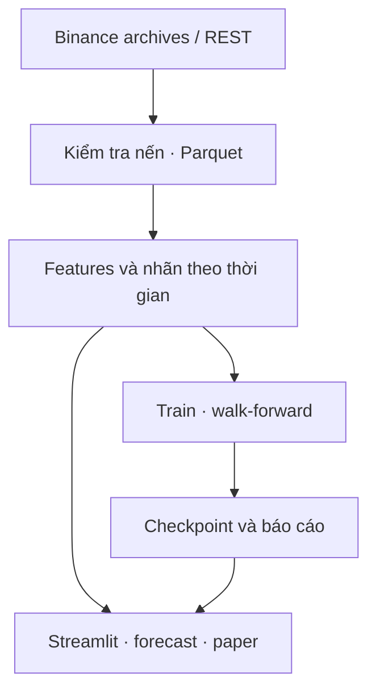

# QuantStream

[](https://github.com/taiiswibu/quantstream-crypto-research/actions/workflows/ci.yml)

Pipeline dữ liệu và machine learning cho BTC/USDT, ETH/USDT: thu thập nến Binance, tạo đặc trưng, huấn luyện, kiểm định theo thời gian và đưa model lên web app local.

**Bản hiện tại: v0.4.1 · Streamlit + Plotly · inference CPU · paper trading.** Phạm vi MVP nghiên cứu đã có luồng chạy local. Kết quả model còn yếu; chưa có bằng chứng đủ để dùng vốn thật. Dự án ghi lại cả những thí nghiệm không vượt baseline.

## Kết quả kiểm tra gần nhất

Lần fit local **20/11/2026**, dùng 67.736 mẫu có nhãn từ lịch sử đã lưu. Các chỉ số dưới đây được tính lại từ dự báo out-of-fold (OOF), gồm **1.878 mẫu: 939 BTC và 939 ETH**, trên cùng cohort cho hai model. Nến tín hiệu từ **07/10/2026 23:00 đến 16/11/2026 11:00 UTC**; nhãn cuối kết thúc **16/11/2026 16:00 UTC**.

| Chỉ số | Ridge | XGBoost |
|---|---:|---:|
| MSE / zero-return, thấp hơn 1 tốt hơn | **0,9961** | 0,9991 |
| MAE | 0,6658% | **0,6625%** |
| Đúng hướng | 46,59% | 52,29% |
| Số fold có MSE thấp hơn zero-return | 2/3 | 1/3 |
| Số dự báo mua vượt ngưỡng 0,60% | 0 | 0 |

Ridge giảm MSE khoảng 0,39% so với dự báo return bằng 0, nhưng MAE của cả hai model vẫn cao hơn baseline này. Baseline hướng cố định “không tăng” đạt 53,09% trên cùng nhãn; đây chỉ là đối chiếu phân loại hướng, không phải chiến lược giao dịch.

Backtest Ridge ở ngưỡng hiện tại có **0 lệnh**, nên return và drawdown bằng 0 không chứng minh hiệu quả đầu tư. Khoảng ước lượng lợi thế MSE theo khối thời gian vẫn chứa mức 0 ở cả hai model. Validation đã được xem để so model; **chưa phải final test độc lập**.


[Báo cáo chi tiết và giới hạn kiểm tra](docs/experiments/local-validation-20261120.md) · [Chỉ số tính lại](reports/experiments/local-validation-20261120/summary.csv) · [Kết quả từng fold/tài sản](reports/experiments/local-validation-20261120/slices.csv)

Các kết quả TCN, Chronos LoRA và model từ notebook thuộc những cohort khác. Không dùng bảng trên để xếp hạng chúng.

## Những phần đã triển khai

| Thành phần | Nội dung |
|---|---|
| Thu thập dữ liệu | Kho nến Binance theo tháng và public REST để cập nhật nến đóng BTC/ETH |
| Kiểm tra dữ liệu | SHA-256, UTC, OHLCV, nến trùng/xung đột, quarantine và khoảng trống thời gian |
| Tiền xử lý | 18 đặc trưng nhân quả; khởi động lại chỉ báo khi chuỗi nến bị ngắt; scaler fit trong train của từng fold |
| Model | Ridge, Logistic Regression, XGBoost, TCN; thí nghiệm GRU và Chronos-2 LoRA riêng |
| Kiểm định | Split theo thời gian dùng chung ranh giới cho các tài sản, purge nhãn chồng lấn, walk-forward và baseline |
| Backtest | Long/cash, vào lệnh trễ, giữ vị thế theo horizon, phí/slippage, tránh vị thế chồng lấn trên cùng tài sản |
| Ứng dụng | Nến và volume, dự báo, sai số, đóng góp feature, quản lý checkpoint và danh mục paper |
| Theo dõi | Ghi forecast theo thời điểm phát hành, chấm sau khi nhãn đủ thời gian, kiểm tra độ mới và feature drift |
| Tái lập | Manifest dữ liệu, hash model, config, source commit, trạng thái code local và CI Linux/Windows |

Stack chính: **Python, pandas, NumPy, PyArrow/Parquet, DuckDB, scikit-learn, XGBoost, PyTorch, Optuna, Streamlit, Plotly, SQLite và GitHub Actions**. Torch và các thư viện nghiên cứu được cài theo nhu cầu; app core dùng model CPU.

## Luồng xử lý



Dữ liệu đầu vào là nến **1 giờ**. Model dự báo return của một vị thế giả định **giữ 4 giờ, sau 1 giờ chờ thực thi**. Ví dụ: quyết định lúc 16:00 UTC, vào giả định lúc 17:00, hết horizon lúc 21:00. Thời gian hiển thị trong app là UTC; timestamp nến mở và thời điểm nến trở nên quan sát được có ý nghĩa khác nhau.

REST là nguồn cập nhật chính của runtime. WebSocket capture là phần tùy chọn để lưu sự kiện nến đóng. Dự án chưa có broker đặt lệnh thật, hệ thống phân tán hoặc dịch vụ nhiều người dùng.

## Chạy web app local

Cần **Python 3.12 64-bit**, Git nếu cập nhật từ repo, và Internet để cài thư viện/nạp dữ liệu. Không cần API key Binance hoặc GPU cho app core.

**Đã có code:** mở PowerShell tại thư mục dự án rồi chạy:

```powershell
.\INSTALL_WINDOWS.cmd
.\START_WINDOWS.cmd
```

Mở [http://127.0.0.1:8501/](http://127.0.0.1:8501/). Những lần sau chỉ cần `START_WINDOWS.cmd`.

**Cài mới từ GitHub:**

```powershell
git clone https://github.com/taiiswibu/quantstream-crypto-research.git
cd quantstream-crypto-research
.\INSTALL_WINDOWS.cmd
.\START_WINDOWS.cmd
```

Lần cài đầu chưa có registry sẽ nạp 90 ngày nến thật và fit Ridge/XGBoost. Đây là dữ liệu khởi động; kết quả có thể khác bảng audit bên trên. Khi đã có registry trong `workspace`, installer giữ model và phiên paper hiện có. [Nạp thêm lịch sử train](docs/LOCAL_HISTORY_VI.md) để dùng dữ liệu quá khứ đã lưu; nạp dữ liệu không tự cập nhật weights.

Linux: `bash START_LINUX.sh`. Worker riêng trên Windows: `WORKER_WINDOWS.cmd`. Dùng một worker; chương trình phải còn chạy và máy phải thức để tiếp tục đồng bộ.

| Trang | Nội dung chính |
|---|---|
| Thị trường | Giá, nến, khối lượng và dự báo return 4 giờ |
| Dự báo | Forecast đã ghi, thời điểm phát hành, sai số và feature |
| Kiểm định | Metrics, baseline, từng fold và mô phỏng validation |
| Danh mục | Vốn giả lập, lệnh, chi phí và equity paper |
| Dữ liệu | Nguồn, health log, lịch sử, fit và nạp model |

Trước khi fit lại hoặc đổi model có phiên paper, dùng luồng **dừng nhận lệnh → chờ thoát vị thế → lưu phiên**. Toàn bộ dữ liệu/model/forecast/paper nằm trong `workspace`; tắt app và worker trước khi sao lưu thư mục này.

Để cập nhật một checkout đã cấu hình remote: giữ các sửa đổi local, dừng app/worker, chạy `git pull --ff-only`, rồi chạy lại installer nếu dependency thay đổi. [Hướng dẫn Windows, vận hành và xử lý lỗi](docs/LOCAL_TERMINAL_VI.md).

## Notebook và thí nghiệm

| Nội dung | Tài liệu |
|---|---|
| Pipeline đầu-cuối: lấy dữ liệu, xử lý, tuning, biểu đồ và xuất model | [Notebook 09](notebooks/09_Kaggle_EndToEnd_Training.ipynb) · [Cách chạy](docs/END_TO_END_TRAINING_VI.md) |
| So sánh model, đánh giá và gói model phục vụ | [Notebook 11](notebooks/11_Final_Research_and_Deployment.ipynb) · [Cách nạp và đọc kết quả](docs/FINAL_RELEASE_VI.md) |
| Phương pháp bổ sung, dữ liệu ngoài và khoảng tham chiếu | [Notebook 12](notebooks/12_Recent_Methods_and_Risk.ipynb) · [Phạm vi và điều kiện sử dụng](docs/METHODS_2026_VI.md) |
| TCN Kaggle và model search | [Run 001](docs/experiments/run-001-kaggle-tcn.md) · [Run 002](docs/experiments/run-002-model-search.md) |
| Chronos-2 LoRA và kiểm tra nhiều seed | [Run 003](docs/experiments/run-003-lora-lab.md) · [Run 004](docs/experiments/run-004-seed-stability.md) |
| Kiểm tra inference với weights cố định | [Protocol Run 005](docs/experiments/run-005-inference-protocol.md) |

Notebook train cần đúng dataset/source snapshot của từng run. Bản Git chứa mã nghiên cứu; kết quả thực thi phải đối chiếu báo cáo và artifact tương ứng. Test CPU, kiểm tra cú pháp notebook hoặc một bước optimizer không thay thế lượt huấn luyện Kaggle đầy đủ.

Các thí nghiệm cũ được giữ làm lịch sử. TCN tham chiếu từng có return sau phí **-14,46%** trên kỳ holdout đã được xem; đọc [báo cáo gốc](reports/reference/final_report.json) và [ghi chép thí nghiệm](docs/EXPERIMENTS.md). Kỳ đó không còn là test chưa quan sát cho một giả thuyết mới.

App core hoạt động độc lập với các extension model thử nghiệm. Adapter Chronos không được tự nối vào paper runtime; model không đạt gate chấp nhận giữ trạng thái nghiên cứu theo metadata. [Quy trình Git và xuất snapshot Kaggle](docs/RESEARCH_LAB_VI.md).

## Kiểm thử và tái lập

```bash
python -m pip install -e ".[dev]"
python -m pytest -q
python -m ruff check quantstream app.py tests scripts
python scripts/check_notebooks.py
```

CI chạy trên Linux và Windows, kiểm tra logic nhân quả, purge nhãn, chi phí, snapshot, paper, provenance và cấu trúc notebook. Phần deep learning phụ thuộc thư viện tùy chọn; kiểm thử tự động không xác nhận lợi nhuận đầu tư hoặc giao diện hoạt động trên mọi máy.

Giữ raw data, credentials, weights, optimizer state và phiên paper ngoài Git. Khi ghi một thí nghiệm mới, lưu snapshot hash, source commit, config, seed, kỳ đánh giá và chi phí. Xem [CONTRIBUTING](CONTRIBUTING.md), [Git workflow](docs/GIT_WORKFLOW_VI.md) và [CHANGELOG](CHANGELOG.md).

## Phạm vi và giới hạn

- Đã có app local và pipeline nghiên cứu để trình bày portfolio. Chưa có bằng chứng về chiến lược sinh lời ổn định.
- Hai tài sản và dữ liệu OHLCV giới hạn khả năng khái quát; backtest chưa mô hình hóa đầy đủ thanh khoản, độ sâu sổ lệnh và capacity.
- CV dùng để so model và checkpoint refit cuối có vai trò khác nhau. Không đánh giá lại quá khứ bằng weights fit sau đó rồi gọi là dự báo ngoài mẫu.
- Việc train lâu hơn, thêm model lớn hoặc tăng biên độ dự báo không tự bảo đảm cải thiện. Giả thuyết tiếp theo cần kỳ đánh giá mới, giữ riêng khỏi tuning.
- App chưa có xác thực nhiều người, vận hành máy chủ 24/7, SLA, kiểm toán bảo mật hoặc kết nối đặt lệnh sàn.

Mã ứng dụng gốc dùng [MIT](LICENSE). Dữ liệu và pretrained weights giữ điều kiện sử dụng của nguồn; license mã nguồn không cấp lại quyền với chúng. [Third-party notices](THIRD_PARTY_NOTICES.md). Kiến trúc có tham khảo FraudGuard, không chép implementation từ repo đó.
