# Báo cáo dự án QuantStream

**Pipeline dữ liệu thị trường, nghiên cứu dự báo và ứng dụng theo dõi local**

QuantStream xử lý dữ liệu nến BTC/USDT và ETH/USDT từ Binance, tạo đặc trưng theo thời gian, huấn luyện model và đưa dự báo lên ứng dụng Streamlit. Dự án tập trung vào một quy trình có thể kiểm tra được: dữ liệu nào được dùng, nhãn có xuất hiện sau quyết định không, model có vượt baseline không và chi phí giao dịch ảnh hưởng thế nào.

Đã triển khai luồng thu thập dữ liệu, kiểm tra chất lượng, train và kiểm định, quản lý checkpoint, inference CPU và paper trading. Lượt notebook minh chứng ngày 21/11/2026 theo giờ Việt Nam chạy lại Ridge/XGBoost trên snapshot 67.820 nến. Kết quả vượt baseline zero-return một lượng nhỏ về MSE nhưng chưa ổn định qua các fold; dự án chưa chứng minh chiến lược đầu tư sinh lời.

## 1. Bài toán và phạm vi

Dữ liệu là nến 1 giờ. Tại thời điểm quyết định `t`, hệ thống chỉ dùng những nến đã đóng và dự báo return của vị thế giả định vào sau 1 giờ, giữ trong 4 giờ. Vì có thời gian chờ thực thi, nhãn của quyết định `t` chỉ đầy đủ lúc `t+5`.

Ví dụ: nến mở 15:00 đóng lúc 16:00 UTC; quyết định dùng dữ liệu đó phát sinh tại 16:00, vào giả định lúc 17:00 và hết horizon lúc 21:00. Timestamp mở nến 15:00 và decision time 16:00 mô tả hai mốc của cùng một nến, không tự tạo ra lỗi lệch dữ liệu.

Ứng dụng phục vụ một người dùng trên máy cá nhân, dùng vốn giả lập và dữ liệu public. Phần model trong app chạy CPU. Dự án chưa có broker đặt lệnh thật, quản lý nhiều tài khoản, vận hành máy chủ 24/7 hoặc SLA.

## 2. Kiến trúc hệ thống

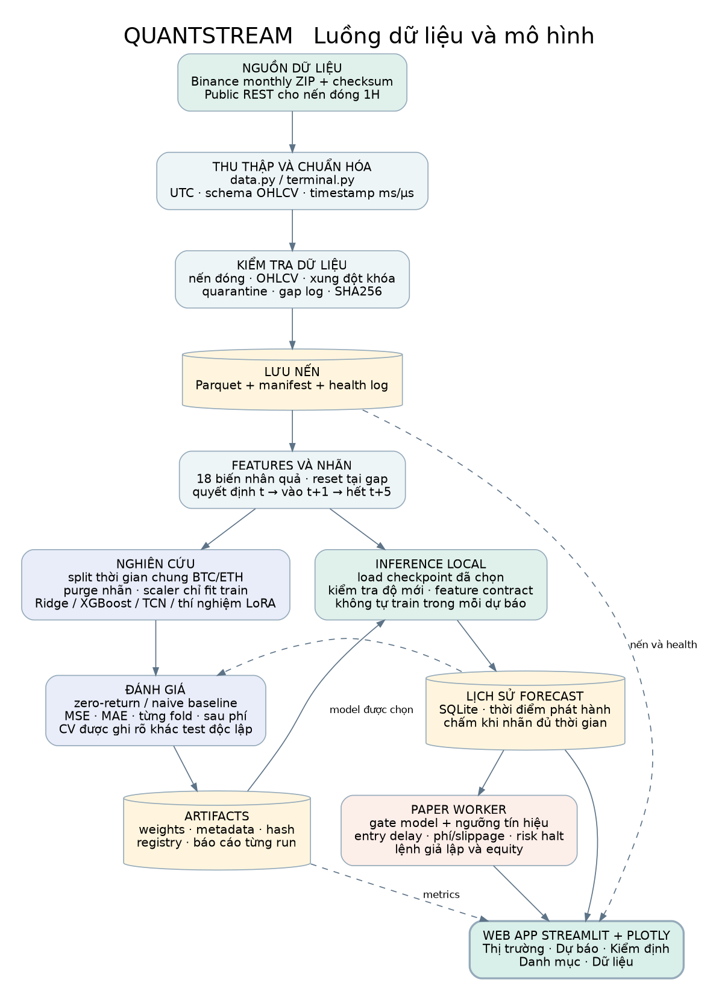

[Sơ đồ SVG để phóng to](../reports/portfolio_cpu/architecture.svg) · [Mã sơ đồ Graphviz](architecture.dot)

Nét liền thể hiện luồng xử lý chính. Các luồng đọc nến/health, metrics và theo dõi nhãn trễ được thể hiện bằng nét đứt. Nhánh nghiên cứu tạo model/artifact; nhánh inference nạp checkpoint đã chọn để phát hành forecast và theo dõi paper. Inference không có bước optimizer tự chạy ở mỗi nến.

| Lớp | Module chính | Đầu vào và đầu ra |
|---|---|---|
| Thu thập | `data.py`, `terminal.py`, `stream.py` | Archive ZIP/REST, chuẩn hóa thành nến có schema chung; WebSocket capture là tùy chọn |
| Chất lượng dữ liệu | `validate_bars`, `history_import.py` | Nến hợp lệ, quarantine, gap log, manifest và kiểm tra xung đột khóa |
| Features và nhãn | `features.py` | 18 biến theo quá khứ, segment liên tục, decision/entry/label end time |
| Nghiên cứu | `research.py`, `deep.py`, `workflow.py`, `final_research.py` | Train theo thời gian, baseline, model search, checkpoint và báo cáo |
| Backtest | `backtest.py` | Tín hiệu long/cash, giả định khớp lệnh trễ, phí/slippage, equity và trades |
| Quản lý model | `terminal.py`, `tcn_import.py`, `forecast_contract.py` | Registry, SHA, kiểm tra cấu hình/feature contract, parity và trạng thái model |
| Serving và theo dõi | `terminal.py`, `paper.py`, `risk_reference.py` | Forecast, nhãn trễ, health, drift và danh mục giả lập |
| Giao diện | `app.py`, `ui_app.py`, `model_ui.py`, `risk_ui.py` | Năm trang Streamlit với biểu đồ Plotly và bảng kiểm định |

## 3. Thu thập và kiểm tra dữ liệu

Dữ liệu lịch sử có nguồn từ Binance monthly public archives và REST catch-up. Mã thu thập so checksum sidecar của ZIP, chuẩn hóa timestamp mili giây/vi giây về UTC và lưu Parquet. Kho nguồn đã ghi nhận 92 archive tháng trong lịch sử nghiên cứu; lượt minh chứng này dùng snapshot đã lưu, không tải lại 92 ZIP.

Snapshot dùng trong Notebook 13 có manifest riêng và được đối chiếu hash trước khi tính toán:

| Thuộc tính | Giá trị |
|---|---|
| Tài sản | BTCUSDT và ETHUSDT |
| Timeframe | 1 giờ |
| Phạm vi mở nến | 01/01/2023 00:00 → 13/11/2026 23:00 UTC |
| Tổng nến | 67.820 |
| Mỗi tài sản | 33.910 |
| Nến thiếu | 4, gồm 2 nến của mỗi tài sản |
| Vị trí gap | Sau 24/03/2023 11:00 UTC |
| Dòng trùng và quarantine trong snapshot | 0 và 0 |
| SHA256 file nến | `1bc980d79b7a5a9c689883aa8d065e67284d7850d605c353dc2ab040ffb1b653` |

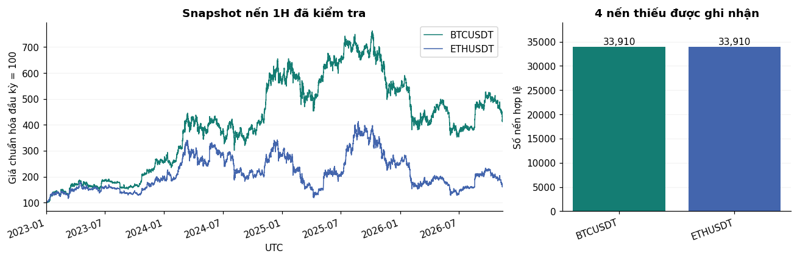

Các kiểm tra gồm tính hữu hạn, giá dương, volume không âm, quan hệ high/low với open/close, thời gian nến và nến đã đóng. Nếu hai bản ghi cùng symbol/timestamp có OHLCV khác nhau, quá trình dừng để kiểm tra nguồn. Dòng không hợp lệ được tách ra, không thay bằng dữ liệu giả.

Gap được lưu lại thay vì nội suy. Features dùng segment liên tục; các rolling indicator được khởi động lại sau gap để một cửa sổ 24 giờ không vô tình trở thành 24 dòng trải qua một khoảng trống.

## 4. Tạo features và chuẩn hóa

| Nhóm | Features | Ý nghĩa |
|---|---|---|
| Return quá khứ | `ret_1`, `ret_4`, `ret_12`, `ret_24` | Chênh lệch log giá đóng ở các độ trễ |
| Biến động | `vol_12`, `vol_48`, `atr_14` | Độ biến động return và biên độ dao động |
| Xu hướng | `rsi_14`, `macd`, `ema_gap` | Trạng thái động lượng và khoảng cách trung bình động |
| Nến và volume | `volume_z`, `range_pct`, `body_pct`, `taker_ratio` | Hình dạng nến, volume và tỷ lệ mua chủ động |
| Chu kỳ thời gian | `hour_sin`, `hour_cos`, `dow_sin`, `dow_cos` | Mã hóa tuần hoàn giờ và ngày trong tuần |

Features được tính từ dữ liệu quan sát được tại decision time. Nhãn là simple return theo giá vào/ra giả định; không dùng log return của feature làm nhãn một cách ngầm định. Những dòng cuối chưa đủ tương lai để có nhãn vẫn có thể dùng cho inference nếu features đã đầy đủ.

Với Ridge, pipeline gồm `StandardScaler` và `Ridge`. Scaler được fit trong tập train của từng fold rồi mới transform validation. Sau CV, scaler/model phục vụ được refit trên toàn bộ nhãn đã biết. Chuẩn hóa trên toàn bộ dữ liệu trước khi chia fold sẽ làm lộ thông tin; thiết kế hiện tại tránh cách đó.

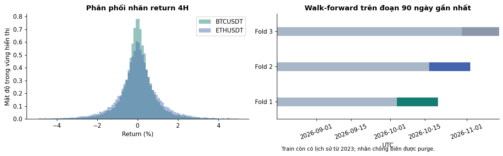

## 5. Chia tập theo thời gian

Local baseline dùng ba fold mở rộng. Ranh giới validation được xác định từ 90 ngày nến gần nhất để việc thêm lịch sử cũ không tự đổi kỳ đánh giá sang giai đoạn cũ. Tập train của mỗi fold có thể dùng lịch sử xa hơn 90 ngày.

Tất cả tài sản dùng chung ranh giới UTC. Điều kiện train là `train.label_end_time < validation_start`; chỉ những nhãn đã đầy đủ trước ranh giới mới được dùng. Validation cũng giới hạn label end trước điểm kết thúc fold. Cách purge này xử lý nhãn 4 giờ có thời gian chờ, tránh để cửa sổ nhãn vượt qua biên tập dữ liệu.

Trong lượt Notebook 13:

- Model cuối fit 67.608 mẫu có nhãn.
- Mỗi model có 1.878 dự báo OOF, gồm 939 mẫu BTC và 939 mẫu ETH.
- Validation bắt đầu 05/10/2026 07:00 UTC; nhãn cuối kết thúc 14/11/2026 00:00 UTC.
- Checkpoint refit cuối khác weights của từng fold. Các metric được tính từ OOF trước bước refit, không chấm lại quá khứ bằng checkpoint cuối.

Validation đã dùng để quan sát và so model; đây chưa phải một final test độc lập mới.

## 6. Model và cách học

### Ridge

Ridge giải bài toán hồi quy với regularization L2. Cấu hình local dùng `alpha=10`, có intercept và StandardScaler. Model nhẹ, inference nhanh và có thể đọc hệ số trên features đã chuẩn hóa. Thời gian fit ngắn không có nghĩa là chưa học xong; Ridge không có loss theo epoch như mạng neural trong cấu hình này.

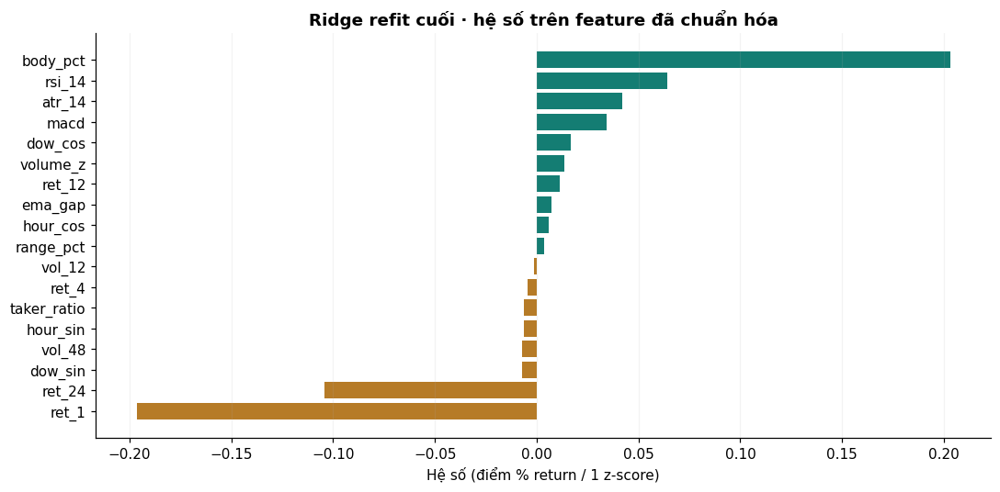

Hệ số cho biết quan hệ tuyến tính theo mô hình và cách chuẩn hóa đã dùng. Nó không chứng minh tác động nhân quả lên giá thị trường.

### XGBoost

Cấu hình baseline dùng 120 cây, `max_depth=3`, `learning_rate=0.04`, `min_child_weight=30`, `subsample=0.85`, `colsample_bytree=0.85`, `reg_lambda=10`, seed 42 và histogram tree method. Model học các quan hệ phi tuyến qua boosting, không dùng hàm kích hoạt neural.

Notebook có một lượt fit chẩn đoán riêng ở fold 1, ghi RMSE train/validation sau từng vòng. Số vòng được giữ cố định ở 120; không chọn epoch tốt nhất từ outer validation rồi báo đó là kiểm định độc lập. Trong đồ thị này, train RMSE giảm nhưng validation gần như phẳng; chưa thấy cải thiện tương ứng trên validation.

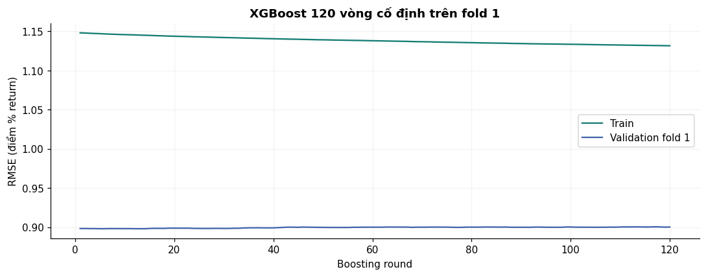

### TCN và các thí nghiệm mở rộng

TCN tham chiếu dùng bốn causal convolution block, kernel size 3, dilation 1/2/4/8, GELU và residual connection. Đầu vào là chuỗi 48 bước với 18 features; head tuyến tính trả một giá trị. Target trong train loop được nhân 100, Huber loss dùng trên thang đó và prediction được chuyển về đơn vị return trước khi chấm MSE/backtest.

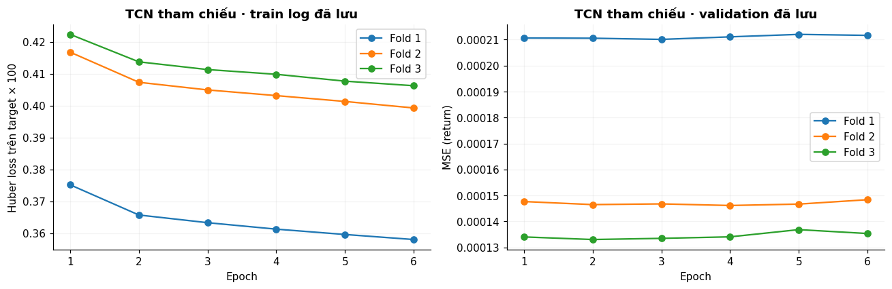

Ảnh trên được vẽ lại từ `reports/reference/tcn_metadata.json`. Nó chứng minh log epoch đã được lưu trong reference run, không phải lượt TCN/GPU mới trong lần hoàn thiện hồ sơ này.

GRU và Chronos-2 LoRA có các nhánh nghiên cứu riêng. Với LoRA, trọng số adapter được học từ base revision đã khóa và so với zero-shot trên cùng cửa sổ. Kết quả fine-tuning không được dùng như bằng chứng lời sau phí. Lượt notebook minh chứng hiện tại không train lại các model này.

## 7. Điều chỉnh siêu tham số

Run 002 trước đây đã ghi 12 trial cho nhiều family, có objective chuẩn hóa theo zero-return và đánh giá nhiều seed cho shortlist. Hồ sơ giữ toàn bộ trial, kể cả cấu hình kém baseline. Các epoch/budget và quy tắc train của run cũ được đọc theo protocol tương ứng, không sửa lại để chọn một kết quả đẹp hơn.

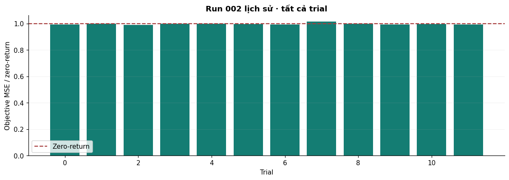

Notebook 13 đọc CSV này để trình bày lại lịch sử, không chạy Optuna mới. Cấu hình Ridge/XGBoost vừa chạy là baseline cố định, không được gọi là cấu hình tối ưu toàn cục. Log và báo cáo của các run được giữ trong [hồ sơ thí nghiệm](EXPERIMENTS.md).

## 8. So sánh baseline và kết quả CPU vừa chạy

Các model và baseline dưới đây được chấm trên cùng 1.878 dòng OOF của Notebook 13:

| Model | MAE return | MSE / zero-return | Đúng hướng |
|---|---:|---:|---:|
| Ridge | 0,6204% | **0,994550** | 46,70% |
| XGBoost | 0,6181% | **0,998255** | 51,28% |
| Zero-return | **0,6170%** | 1,000000 | 53,25% |
| Naive return 4H trước đó | 0,9430% | 2,071623 | 49,52% |

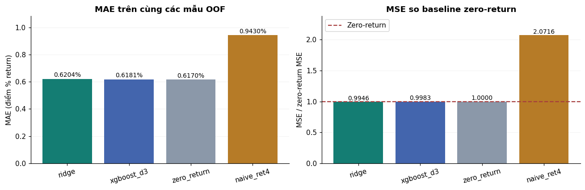

Zero-return luôn dự báo 0; naive dùng return quá khứ theo công thức đã lưu trong code. DA dùng quy ước `return > 0`; trường hợp bằng 0 được xếp cùng nhóm không tăng. Vì vậy DA của zero-return không có nghĩa model này đoán đúng chiều tăng, và cũng không phải một chiến lược bán khống.

Ridge giảm MSE khoảng 0,545% so zero-return; XGBoost giảm khoảng 0,174%. MAE của cả hai vẫn kém zero-return. Đánh giá theo fold tiếp tục cho thấy sự không ổn định:

| Fold | Ridge MSE / zero | XGBoost MSE / zero |
|---|---:|---:|
| 1 | 0,986099 | 1,010488 |
| 2 | 1,022540 | 1,010154 |
| 3 | 0,983575 | 0,983918 |

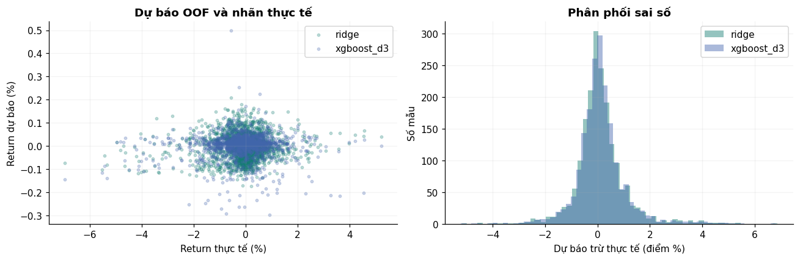

Kết quả này cho thấy pipeline train/chấm chạy được và có lợi thế MSE nhỏ trên cohort đã xem. Nó chưa đủ để kết luận model dự báo tốt qua các chế độ thị trường. Biên độ forecast nhỏ cũng chưa đủ để quy lỗi cho alpha hoặc underfit khi chưa có thử nghiệm đối chứng.

### Phân biệt với audit local 20/11

Lần audit local 20/11 dùng kỳ nhãn 07/10 → 16/11/2026 và model fit 67.736 mẫu. Ridge có MSE/zero 0,9961, XGBoost 0,9991; cả hai không có forecast mua vượt 0,60%. Đây là cohort khác với snapshot Notebook 13, dù cùng có 1.878 mẫu/model. Không lấy chênh lệch hai bảng làm phần trăm cải thiện model.

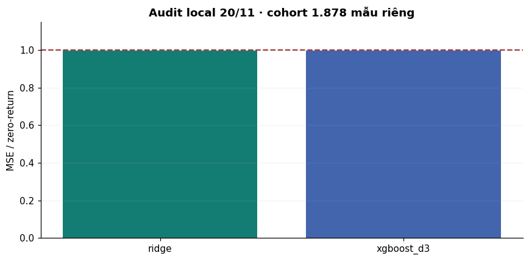

[Báo cáo audit và kiểm tra bất định](experiments/local-validation-20261120.md).

## 9. Chiến lược mô phỏng và chi phí

Backtest là long/cash, một vị thế trên mỗi tài sản, không dùng đòn bẩy. Tín hiệu được vào sau một full hourly bar, giữ theo horizon và chịu phí/slippage. Với cấu hình local: phí 10 bps cộng slippage 5 bps mỗi chiều, vốn mỗi lệnh 10% phần vốn tài sản và drawdown halt 10%.

Ngưỡng forecast long 0,60% là điều kiện ra tín hiệu, không phải mức lợi nhuận đã thực hiện. Quy tắc tránh chồng vị thế, kiểm tra đủ nến liên tục và đóng vị thế theo horizon/risk halt được áp dụng trong simulator.

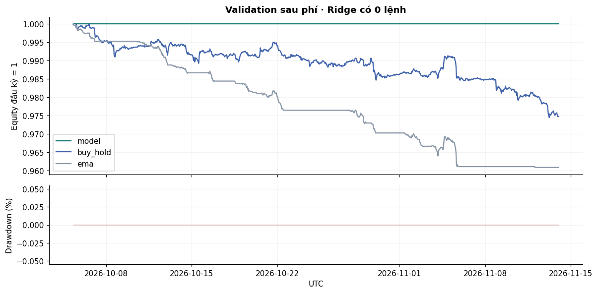

Đường Ridge phẳng và số lệnh bằng 0 ở cấu hình này. Không coi việc đứng ngoài thị trường là bằng chứng model dự báo giỏi hoặc chiến lược an toàn. Buy-and-hold/EMA có exposure khác nhau; chỉ so return hoặc drawdown mà bỏ qua exposure sẽ gây hiểu sai.

Reference TCN có một kỳ holdout khác, từ 25/01 đến 01/11/2026, với return sau phí -14,46%, drawdown -17,09% và 46 lệnh. Reference dùng position fraction 95%, khác local 10%. Kỳ holdout đó đã được xem, nên không còn là test chưa quan sát cho một giả thuyết mới. [Báo cáo reference](../reports/reference/final_report.json).

## 10. Đưa model vào ứng dụng

Model cuối được lưu cùng metadata, feature order, config và SHA. Import bundle kiểm tra tính tương thích và prediction parity; model đã nhập giữ trạng thái chấp nhận/nghiên cứu từ metadata. Một checkpoint `research_validation_failed` không được tự nâng lên model nhận lệnh paper.

Luồng vận hành gồm: đồng bộ nến đóng → kiểm tra độ mới → tính feature theo cùng code → nạp model đã chọn → ghi forecast theo thời điểm phát hành → theo dõi khi nhãn đủ thời gian. Các forecast sau triển khai được giữ trong SQLite; chúng khác với OOF phục vụ nghiên cứu.

| Trang | Chức năng đã có |
|---|---|
| Thị trường | Giá/ticker, nến, volume và thời gian forecast |
| Dự báo | Lịch sử đã phát hành, feature và khoảng tham chiếu |
| Kiểm định | Baseline, sai số, từng fold, mô phỏng và artifact |
| Danh mục | Vốn giả lập, lệnh, equity và quản lý phiên paper |
| Dữ liệu | Health, nguồn, hash, nạp lịch sử, fit và import model |

Thay model hoặc refit phải tôn trọng phiên paper đang mở. Runtime có file lock, kiểm tra vị thế và luồng lưu phiên; không dùng việc xóa state để bỏ guard. Hướng dẫn CLI đầy đủ nằm trong [Vận hành](VAN_HANH_VI.md).

## 11. Minh chứng thực thi và tái lập

Hai notebook được chạy cho bộ hồ sơ này:

- [Notebook 13](../notebooks/13_Project_Evidence_VI.ipynb): nạp snapshot đã đối chiếu SHA, kiểm tra dữ liệu, train Ridge/XGBoost, baseline, learning curve và các hình minh chứng.
- [Notebook 08](../notebooks/08_Local_Model_Review.ipynb): đọc lại artifact CPU vừa tạo và vẽ dữ liệu, kiểm định, sai số, equity và cấu hình model.

Ảnh trong báo cáo được trích nguyên byte từ output notebook. [Manifest Notebook 13](../reports/portfolio_cpu/figures/13_Project_Evidence_VI-images.json) và [manifest Notebook 08](../reports/portfolio_cpu/figures/08_Local_Model_Review-images.json) chỉ ra notebook hash, cell, execution count và image hash. Các ảnh là output notebook; không được gọi là screenshot giao diện Windows hoặc một lượt Kaggle mới.

[Execution record](../reports/portfolio_cpu/execution.json) ghi input hash, code hashes, model hashes, số mẫu, kỳ validation và việc không train GPU/TCN mới. Các CSV metrics được lưu kèm để không phải đọc số từ ảnh.

Bản chỉnh sửa đã qua 110 bài pytest trên Linux CPU, lint, kiểm tra schema/cú pháp 14 notebook, compile và AppTest của cả năm trang. Đây là kiểm tra phần mềm trên môi trường thực thi; chưa phải kiểm tra giao diện trên máy Windows thật. [Kết quả kiểm tra](../reports/portfolio_cpu/software_checks.json).

Raw nến, weights, SQLite và phiên paper giữ ngoài Git. Muốn tái lập đúng cohort cần đúng snapshot, dependency và config; dùng dữ liệu mới phải ghi thành một run riêng. Các notebook Kaggle còn lại giữ quy trình và nguồn của từng thí nghiệm, không được đánh dấu đã chạy lại trong lần này.

## 12. Năng lực thể hiện qua dự án

| Nhóm năng lực | Phần việc có trong hệ thống |
|---|---|
| Data engineering | Ingestion đa nguồn archive/REST, schema thời gian, Parquet, checksum, quarantine, gap và dữ liệu cập nhật |
| Machine learning | Feature engineering, pipeline chuẩn hóa, model tuyến tính/cây/chuỗi, baseline, walk-forward và phân tích lỗi |
| ML engineering | Metadata/checkpoint, feature contract, import parity, hash, source provenance và inference CPU |
| Phân tích định lượng | Target theo thời gian thực thi, phí/slippage, exposure, drawdown và phân biệt forecast metric với PnL |
| Sản phẩm dữ liệu | Streamlit/Plotly, quản lý model, lịch sử forecast và phiên paper có trạng thái |
| Chất lượng phần mềm | Unit tests, kiểm tra nhân quả/chi phí, notebook validation và CI Linux/Windows |

Mô tả ngắn có thể dùng trong hồ sơ dự án:

> Xây dựng pipeline nghiên cứu dự báo crypto và ứng dụng theo dõi local cho BTC/USDT, ETH/USDT. Xử lý snapshot 67.820 nến 1H, tạo 18 features nhân quả, đánh giá Ridge/XGBoost với baseline trên ba fold thời gian có purge. Triển khai inference CPU, quản lý checkpoint/hash và paper trading qua Streamlit/Plotly; lưu notebook thực thi, biểu đồ và kiểm thử CI. Kết quả dự báo còn yếu và được báo cáo cùng giới hạn kiểm định.

## 13. Kết luận

Đã hoàn thành phạm vi một sản phẩm nghiên cứu local có luồng dữ liệu, model, kiểm định và giao diện. Kết quả âm hoặc cải thiện rất nhỏ được giữ lại làm bằng chứng đánh giá, không đổi thành tuyên bố model đầu tư đã đạt yêu cầu.

Nếu mở nghiên cứu tiếp, ưu tiên một giả thuyết có thể kiểm chứng, so trên cùng cohort và giữ kỳ tương lai riêng khỏi tuning. Việc chạy thêm giờ GPU hoặc chọn một ảnh đẹp hơn không thay thế tiêu chí đó.

Mã ứng dụng gốc theo MIT; dữ liệu và pretrained weights giữ điều kiện sử dụng riêng. [Nguồn và giấy phép](../THIRD_PARTY_NOTICES.md).
