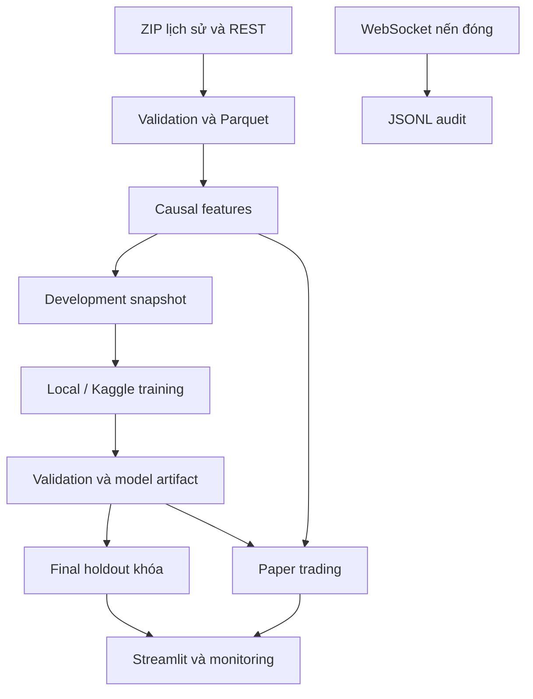

> Hướng dẫn này dành cho gói MVP đầy đủ đã bàn giao trước Git. Source repo không chứa dữ liệu/model sinh ra; xem README gốc để chạy từ Git checkout mới.

# QuantStream Local

MVP nghiên cứu Quant chạy local, dùng dữ liệu BTC/USDT và ETH/USDT thật từ Binance. Có tải lịch sử, kiểm tra dữ liệu, 18 features, walk-forward, Ridge/Logistic/XGBoost, TCN PyTorch, LoRA Chronos-2, backtest có chi phí, paper trading và dashboard.

**Mở `BAO_CAO_KET_QUA.html` để xem kết quả chạy thật, kể cả khi chưa cài Python.** Báo cáo ghi nguyên kết quả âm sau phí. Đây là dự án nghiên cứu, chưa phải chiến lược đạt yêu cầu giao dịch.

`QuantStream_Kaggle_Input.zip` được cung cấp riêng để tránh lặp dữ liệu trong gói local. Có thể đặt tệp đó cạnh notebook hoặc tạo lại bằng `python -m quantstream export-kaggle`.

## 1. Chạy nhanh trên Windows

1. Cài Python **3.11 hoặc 3.12** từ python.org; bật thêm Python vào PATH.
2. Giải nén toàn bộ thư mục vào ví dụ `D:\Code\QuantStream_Local`.
3. Nhấp đúp **`START_WINDOWS.bat`**. Lần đầu file tạo môi trường Python và cài thư viện. Nếu champion là TCN, script cài PyTorch bản CPU.
4. Mở **http://127.0.0.1:8501**. Gói đã có dữ liệu, model và kết quả nên có thể xem dashboard ngay sau khi cài.

Không cần Docker, tài khoản sàn, API key giao dịch hoặc VPS. Tải thư viện cần Internet. Dashboard chỉ lắng nghe trên máy local.

Chạy bằng PowerShell nếu muốn kiểm soát từng bước:

```powershell
cd D:\Code\QuantStream_Local
py -3.12 -m venv .venv
.\.venv\Scripts\python.exe -m pip install -e .
.\.venv\Scripts\python.exe -m pip install torch --index-url https://download.pytorch.org/whl/cpu
.\.venv\Scripts\python.exe -m streamlit run app.py
```

Gói không kèm môi trường Python hoặc model Chronos gốc. PyTorch và checkpoint gốc cần tải riêng khi chạy phần DL/fine-tuning. Các tệp checkpoint TCN nhỏ và LoRA adapter đã được kèm trong gói.

## 2. Kiến trúc và dữ liệu



- Dữ liệu gốc: Binance Spot public archives, nến 1 giờ, `2023-01` đến `2026-10`, hai tài sản.
- ZIP được đối chiếu SHA-256 với `.CHECKSUM`; giữ URL và hash trong `source_manifest.json`.
- Parser nhận cả timestamp millisecond và microsecond. Dữ liệu lưu UTC.
- Invalid OHLC, volume, close time hoặc timestamp được quarantine. Payload cùng key nhưng khác giá trị làm pipeline dừng.
- Nến thiếu không được tạo giả; indicators và sequence khởi động lại sau gap.
- `quantstream stream` lưu event nến đóng làm audit, có reconnect. Paper runtime sử dụng REST catch-up làm nguồn canonical; stream không trực tiếp phát lệnh.
- `refresh` cập nhật bars để chạy paper, nhưng không tự viết lại feature snapshot dùng cho thí nghiệm đã khóa.

Lịch sử tải từ https://data.binance.vision/ ; public REST từ `data-api.binance.vision` ; public WebSocket từ `data-stream.binance.vision`.

## 3. Bài toán và chống leakage

Nến có `timestamp=t` được quan sát khi đóng tại `decision_time=t+1h`. Sau tín hiệu, mặc định **chờ thêm 1 nến đầy đủ**, vào ở open của nến `t+2h`, giữ 4 nến và thoát ở close của nến `t+5h`. Nhãn đúng với lợi suất chưa trừ phí của khoảng giữ này. Không giả định khớp ngay tại giá đóng vừa dùng để tính feature.

18 features: returns 1/4/12/24h, volatility 12/48h, RSI, MACD, ATR, volume z-score, biên độ/thân nến, taker ratio, EMA gap và thời gian theo sin/cos. Train và inference gọi cùng `build_features`.

Các split dùng chung mốc thời gian cho BTC và ETH. Train chỉ giữ dòng có **label_end_time < validation_start**. Validation chỉ giữ dòng có **label_end_time < validation_end**. Khoảng cuối 20% dành cho final holdout. Scaler chỉ fit trên train của từng fold. Không dùng random split.

Baseline và XGBoost so sánh 3 fold. TCN cũng chạy cùng 3 fold, chọn epoch bằng validation MSE, chọn threshold bằng hiệu quả chiến lược trên development. TCN cuối được refit trên toàn bộ development, với số epoch là trung vị các epoch đã chọn. Logistic dự báo xác suất tăng; các model còn lại dự báo lợi suất.

`final_test_lock.json` ngăn mở lại holdout với một model khác. Gói bàn giao đã có lượt final test chạy thật, vì vậy test này **đã được xem**. Model cải tiến về sau cần một giai đoạn tương lai mới để đưa ra kết luận độc lập; có thể dùng validation để học hoặc paper trading để kiểm tra tiến về phía trước. Đừng xóa lock để tuyên bố cùng test vẫn là unseen.

## 4. Các lệnh chính

Chạy trong thư mục dự án sau khi cài `pip install -e .`; có thể dùng `python` từ môi trường ảo thay cho `quantstream`.

```bash
python -m quantstream doctor
python -m quantstream download
python -m quantstream prepare
python -m quantstream research
python -m quantstream export-kaggle
# Sau khi chọn champion, evaluate mở final holdout đúng một lần:
python -m quantstream evaluate
```

`python -m quantstream demo` gộp download → prepare → research → export Kaggle, chưa tự mở holdout. Nó tạo một run baseline mới và cập nhật champion. Vì vậy, nếu chỉ muốn xem gói đã chạy, chỉ cần mở dashboard; không cần chạy demo lại.

Tất cả cấu hình trong `config.json`: assets, thời gian, phí, slippage, horizon, delay, risk, lookback, seed và số thread. Đổi cấu hình nghiên cứu thì chạy lại prepare/research trong một thư mục thí nghiệm mới. Bản MVP hỗ trợ nến 1 giờ.

## 5. Train PyTorch và fine-tune trên Kaggle

Hai notebook đã chuẩn bị:

- `notebooks/02_Kaggle_TCN.ipynb`: tự train TCN bằng PyTorch, walk-forward, checkpoint và final development refit.
- `notebooks/03_Kaggle_Chronos_LoRA.ipynb`: so sánh pretrained zero-shot với LoRA trên cùng các cửa sổ validation.

Các bước:

1. Tạo Kaggle Dataset riêng tư và upload **`QuantStream_Kaggle_Input.zip`**.
2. Import notebook tương ứng vào Kaggle; Add Input dataset vừa tạo.
3. Bật Internet; chọn GPU nếu tài khoản đang có GPU/hạn mức. Chạy các cell theo thứ tự.
4. Download `TCN_Kaggle_Output.zip` hoặc `Chronos_Kaggle_Output.zip` trong Output.

Input ZIP chỉ chứa **development data**, mã nguồn và manifest; không chứa final holdout. Dùng notebook không có nghĩa là đã tham gia competition hoặc có leaderboard score.

Đưa TCN về local sau khi giải nén output:

```bash
python -m quantstream register-tcn artifacts/kaggle_tcn
```

Lệnh kiểm tra dataset hash, checkpoint hash và load weights-only. Lệnh này chọn model để inference/paper; nếu final holdout cũ đã mở thì evaluate vẫn chặn tái sử dụng nó. So sánh báo cáo validation trước khi chọn model. Nếu đổi model đang có paper state, dùng `paper-reset` để lưu trữ state cũ rồi bắt đầu phiên mới.

Có thể chạy TCN trực tiếp trên local:

```bash
python -m quantstream tcn-train --snapshot kaggle_export --output artifacts/my_tcn --epochs 8 --device cpu
```

Chạy Chronos tại local nếu muốn (nặng hơn, nên chạy trên Kaggle):

```bash
python -m pip install -e ".[finetune]"
python -m quantstream chronos-finetune --snapshot kaggle_export --output artifacts/my_chronos --steps 200 --max-windows 512
```

LoRA là fine-tuning trọng số model pretrained. Grid depth/threshold của XGBoost là hyperparameter/strategy tuning. Đây là hai công việc khác nhau.

Chronos dùng log-price quá khứ, không truyền giá hoặc volume tương lai vào covariates. Giá entry tương lai được xấp xỉ bằng dự báo close trước entry. Lượt LoRA trong gói là exploratory trên validation lấy mẫu; chưa xác minh dữ liệu pretraining của checkpoint có trùng giai đoạn đánh giá. Vì vậy adapter không tự tham gia lựa chọn champion hay final test. Gói có resolved revision của checkpoint và so sánh trước/sau; fine-tune có thể làm kết quả xấu đi.

## 6. Paper trading và monitoring

```bash
python -m quantstream paper
python -m quantstream paper --watch --poll-seconds 60
python -m quantstream stream
```

- Paper khởi tạo 10.000 USDT mô phỏng, chia đều thành các phần vốn theo tài sản; mỗi vị thế dùng 95% phần vốn của tài sản đó.
- Chỉ một vị thế mỗi tài sản; không short và không đòn bẩy.
- Vào lệnh tại thời gian đã lên lịch nếu worker hoạt động trong cửa sổ 2 phút. Máy tắt hoặc bỏ lỡ cửa sổ thì signal bị bỏ, không tạo giao dịch hồi tố.
- Thoát sau 4 giờ theo giá ticker quan sát lúc worker chạy; lưu cả độ trễ. Đây là paper fill, khác xấp xỉ fill OHLCV của backtest.
- Halt khi drawdown theo phần vốn đạt 20%. Khi đổi model, paper state cũ phải được archive để lịch sử không trộn model.
- Theo dõi data age, PSI của 18 feature so với development, và chất lượng dự báo sau khi nhãn tương lai đã đủ thời gian hình thành. PSI >= 0.25 chỉ là ngưỡng xem xét; hệ thống không tự retrain hoặc tự đổi model.
- Dashboard là giao diện đọc trạng thái; muốn worker hoạt động liên tục phải giữ lệnh `paper --watch` chạy. Tắt máy thì worker dừng.

Không có hàm gửi order đến sàn trong dự án này. Các request chỉ đọc market data công khai.

## 7. Kết quả, kiểm thử và cấu trúc

- `BAO_CAO_KET_QUA.html`: báo cáo offline, có biểu đồ tương tác và kết quả thật.
- `notebooks/01_Research_Results.ipynb`: notebook đã chạy, đọc dữ liệu/model/report và vẽ kết quả.
- `runs/<run_id>/`: predictions, equity, trades, comparison, model và final report.
- `artifacts/tcn_training/`: weights, lịch sử các fold và metadata.
- `artifacts/chronos_200/`: LoRA adapter, validation predictions, metrics và manifest.
- `data/processed/`: dữ liệu chuẩn hóa, features, split và manifests.
- `data/raw/`: ZIP nguồn cùng checksum; `data/quarantine/`: các dòng không qua kiểm tra.
- `paper/`: state, predictions, event log, drift và equity.
- `VERIFICATION.json`: những kiểm tra thực sự đã hoàn tất trong môi trường tạo gói.

```bash
python -m pip install -e ".[dev]"
python -m pytest -q
```

Tests dùng dữ liệu tạo riêng để kiểm tra timestamp ms/us, quarantine, causality, purge, kế toán phí, vị thế không chồng lấn, TCN causal, PSI, paper idempotence và bỏ lệnh trễ. Dữ liệu kiểm thử này không được đưa vào dataset train.

Backtest dùng OHLCV nên không kiểm tra order-book liquidity, market impact hay capacity. Hai tài sản được chọn không đại diện cho toàn thị trường. Sharpe quy đổi sqrt(8760) chưa hiệu chỉnh tự tương quan. Phí/slippage trong config là giả định nghiên cứu. Các hạn chế và kết quả âm được giữ trong báo cáo.

## 8. Kế hoạch tiếp tục trong 2 ngày

Ngày 1: chạy bản có sẵn, đọc notebook kết quả, giải thích feature/label/split, kiểm tra ảnh hưởng chi phí bằng development data. Ngày 2: chạy notebook Kaggle, đọc so sánh trước/sau fine-tune, chạy paper worker và chuẩn bị demo kiến trúc, data quality, reproducibility và kết luận nghiên cứu.

Để mở rộng DE sau MVP: thêm Kafka/Schema Registry, MinIO, orchestration và warehouse theo nhu cầu đo được. Bản hiện tại ưu tiên chạy được trên máy 16 GB RAM và không thuê dịch vụ.

## 9. Nguồn tham khảo

Tham khảo ý tưởng kiến trúc từ [FraudGuard](https://github.com/ItsLewis-DE/fraudguard-streaming-pipeline), commit `5144d6d63dc38b4af0e0a68fd8638f369d35a7a4`: data contracts, replay, quarantine, immutable snapshots và temporal evaluation. Mã Quant trong gói được viết mới; không copy implementation từ repo này.

API và dữ liệu: [Binance public archives](https://github.com/binance/binance-public-data), [Binance Spot API docs](https://github.com/binance/binance-spot-api-docs), [Chronos official](https://github.com/amazon-science/chronos-forecasting), [Kaggle CLI](https://github.com/Kaggle/kaggle-cli).

Xem `THIRD_PARTY_NOTICES.md` cho mô hình và thư viện bên thứ ba.
