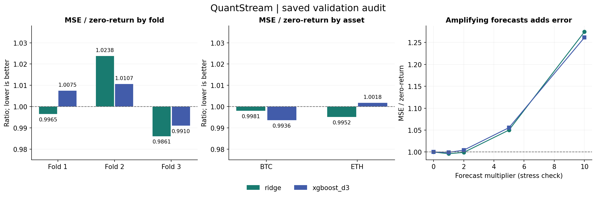

# Kiểm tra validation local · 20/11/2026

## Phạm vi

Đối chiếu ba file do người chạy ứng dụng cung cấp: registry, dự báo validation và backtest Ridge. Bộ kiểm tra gồm 3.756 dòng dự báo cho hai model, tương ứng 1.878 khóa tài sản/thời điểm duy nhất trên mỗi model. Hai model có cùng thời điểm, tài sản, nhãn và fold; không thấy dòng trùng khóa, giá trị thiếu hoặc prediction/target không hữu hạn.

| Thông tin | Giá trị |
|---|---|
| Tài sản | BTCUSDT, ETHUSDT; mỗi tài sản 939 mẫu/model |
| Số fold | 3; lần lượt 622, 622 và 634 mẫu/model |
| Quyết định đầu/cuối | 07/10/2026 23:00 → 16/11/2026 11:00 UTC |
| Nhãn cuối | 16/11/2026 16:00 UTC |
| Số mẫu fit cuối theo registry | 67.736 |
| Nhãn train cuối theo registry | 16/11/2026 16:00 UTC |
| Thời điểm fit Ridge | 20/11/2026 16:20:35 UTC |
| Source commit ghi trong registry | `8e4130f4b9fba578a4bc9f0abf28633f3ffdc254` |
| Code local | `dirty=true`; commit chưa đủ tái dựng toàn bộ thay đổi local |
| Trạng thái triển khai | `paper_only_baseline` |
| Final test độc lập | Chưa có trong bộ kiểm tra này |

Source commit mô tả code được ghi nhận, không phải source sạch đã được xác minh byte-for-byte. Nhãn cách quyết định 5 giờ phù hợp 1 giờ chờ và horizon 4 giờ; chưa có raw candles để tính lại công thức target.

## Kết quả

| Chỉ số | Ridge | XGBoost |
|---|---:|---:|
| MSE / zero-return | 0,996099 | 0,999129 |
| MAE | 0,665806% | 0,662478% |
| Đúng hướng | 46,5921% | 52,2897% |
| Fold 1: MSE / zero | 0,996487 | 1,007532 |
| Fold 2: MSE / zero | 1,023808 | 1,010661 |
| Fold 3: MSE / zero | 0,986101 | 0,991008 |
| BTC: MSE / zero | 0,998071 | 0,993595 |
| ETH: MSE / zero | 0,995160 | 1,001764 |
| Dự báo mua > 0,30% | 0 | 1 |
| Dự báo mua > 0,60% | 0 | 0 |
| Dự báo lớn nhất | +0,290342% | +0,486894% |

Các chỉ số MSE, tỷ lệ MSE, MAE, đúng hướng và tỷ lệ MSE từng fold tính lại khớp registry. MSE/zero là `mean((target-prediction)^2) / mean(target^2)`. DA là tỷ lệ `(target > 0) == (prediction > 0)`; một nhãn bằng 0 được tính là không tăng. Dùng `np.sign` sẽ khác một mẫu với quy ước của app.

MAE của zero-return là khoảng 0,6621%. Baseline hướng cố định không tăng đạt 53,09%; đây không phải chiến lược bán khống hoặc khẳng định có thể giao dịch theo tỷ lệ đó. Fold 3 chiếm 54,51% tổng bình phương nhãn và mang lại phần lớn lợi thế MSE gộp. Đây là phân rã sai số, chưa phải chứng minh nguyên nhân theo chế độ thị trường.

File backtest Ridge ghi 0 lệnh, return 0%, drawdown 0% ở ngưỡng mua 0,60%. Kết quả tương thích với việc không có prediction vượt ngưỡng; chưa chứng minh hiệu quả đầu tư. Bộ kiểm tra không có file backtest riêng của XGBoost; số 0 ở bảng là số dự báo vượt ngưỡng, không phải một backtest mới đã chạy.

## Bất định và phép thử biên độ

Lấy mẫu theo khối tròn 24/72/168 giờ trong từng fold, giữ hai tài sản cùng thời điểm, 2.000 lượt, seed `20261120 + block_hours`. Chỉ số bootstrap là phần trăm giảm MSE so zero-return trên các mẫu được lấy lại. Với khối 24 giờ, khoảng percentile 95% là:

- Ridge: **[-0,6854%; +1,4510%]**.
- XGBoost: **[-1,4571%; +1,4173%]**.

Cả hai đều chứa mức lợi thế 0. Đây là chẩn đoán xấp xỉ trên validation đã được xem lại, không phải kiểm định độc lập hay xác suất sinh lời tương lai. Khối 168 giờ trong fold dài khoảng 13 ngày có rất ít khối độc lập; đọc cùng kết quả khối ngắn hơn trong [bảng khoảng ước lượng](../../reports/experiments/local-validation-20261120/block_intervals.csv).

Nhân các dự báo đã lưu lên 5 lần làm MSE / zero tăng thành 1,0501 với Ridge và 1,0556 với XGBoost. Nhân 10 lần tương ứng 1,2743 và 1,2613. Đây là phép thử độ nhạy trên cùng OOF, không phải model mới được huấn luyện hoặc chọn để triển khai. Không hạ ngưỡng hoặc khuếch đại forecast chỉ để tạo lệnh.

## Giới hạn và bàn giao

Ba file không chứa raw candles, ma trận feature hoặc bytes checkpoint. Chưa xác minh trực tiếp công thức nhãn, scaler, trọng số hoặc tác động của sửa đổi local. Không quy nguyên nhân cho data hoặc thuật toán từ các chỉ số này.

Model cuối được refit trên toàn bộ dữ liệu có nhãn sau khi tạo dự báo từng fold; không cộng training_rows và OOF rows để suy ra số mẫu duy nhất. TCN và model Notebook 11 không có dự báo trên đúng cohort này trong file gửi, nên không đưa vào bảng xếp hạng.

Đã có đủ thành phần cho phạm vi portfolio nghiên cứu: pipeline, web app, baseline và bằng chứng kiểm định. Vòng tuning hiện tại có thể chốt với kết luận chưa có lợi thế ổn định. Thử nghiệm sau, nếu tiếp tục, cần snapshot/code tái dựng được, so sánh các cửa sổ train hoặc cách gộp tài sản trên cùng cohort, rồi đánh giá một giai đoạn mới giữ riêng khỏi tuning.

Repo chỉ lưu chỉ số, biểu đồ và hash kiểm tra; dữ liệu OOF gốc, registry đầy đủ, weights và trạng thái paper được giữ ngoài Git. Mã tính lại, notebook đã thực thi và ba đầu vào được bàn giao riêng trong `QuantStream_Validation_Audit_20261120.zip`.

[Summary](../../reports/experiments/local-validation-20261120/summary.csv) · [Từng fold/tài sản](../../reports/experiments/local-validation-20261120/slices.csv) · [Phân rã MSE](../../reports/experiments/local-validation-20261120/fold_contributions.csv) · [Mốc thời gian](../../reports/experiments/local-validation-20261120/fold_dates.csv) · [Phép thử biên độ](../../reports/experiments/local-validation-20261120/scaling_stress.csv) · [Hash và kiểm tra](../../reports/experiments/local-validation-20261120/verification.json)
