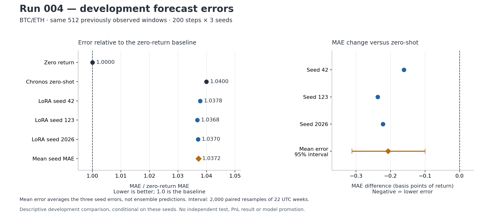

# Run 004 — LoRA seed stability

Status: **completed; forecast metrics and trainer evidence verified; `research_only_no_promotion`**. Completed at 00:15 ICT on 2026-11-12 (2026-11-11 17:15 UTC). No independent holdout, new PnL result or model promotion.

## Result

All three fixed LoRA B seeds have lower MAE than Chronos zero-shot on the same previously observed development sample. Mean seed MAE is **0.0078152940**, a **0.2642% relative reduction** versus zero-shot. However, it is **3.7212% higher** than predicting return zero. Mean directional accuracy is **49.7396%**, versus **50.1953%** for zero-shot. This is a narrow forecast-error improvement against a weaker baseline, not evidence of a trading edge.

| Model / seed | MAE | MSE / zero-return MSE | Directional accuracy |
| --- | ---: | ---: | ---: |
| Zero return | 0.0075349066 | 1.000000 | 48.4375% |
| Chronos-2 zero-shot | 0.0078359965 | 1.063231 | 50.1953% |
| LoRA B / 42 | 0.0078198427 | 1.057309 | 49.4141% |
| LoRA B / 123 | 0.0078122765 | 1.055934 | 50.0000% |
| LoRA B / 2026 | 0.0078137627 | 1.055709 | 49.8047% |

Lower MAE is better. Normalized MSE below 1 would beat zero-return forecasting; none of these Chronos/LoRA rows does. Zero-return directional accuracy uses the code's `prediction > 0` convention and is class prevalence, not an informative directional forecast. Mean across seed errors is not the performance of an ensemble forecast.



## Protocol and evidence

- Predeclared [protocol](run-004-seed-stability-protocol.md) and [reviewed Kaggle preflight](run-004-preflight.md); execution source `bb47737b5bc400169a8bbd75f8c7534503ba18d5` with a clean checkout recorded in the plan. Code/protocol hashes match the Git objects.
- Source protocol SHA-256 `32d6cb80433ca147d799e17ddd9d45ae9e383ff9b17b21dab1096202b6722441`; reviewed lock `b8e06d61a24e3f42b067d0877f67dfd2f166a84e52a540539730a5ccad1a3900` matches the entire frozen part of `plan.json`.
- Same `amazon/chronos-2` revision `29ec3766d36d6f73f0696f85560a422f50e8498c`; seeds **42/123/2026**, **200 steps each**, learning rate **1e-5**, context **128**, batch **8**, rank **8**, alpha **16**, declared target modules. Each fit reloads the base; no seed replaces a failed or unfavorable result.
- ZIP: `QuantStream_Run004_Output.zip`, SHA-256 `0c53a0dabcd2c67e3c36993628d9495c4027d950840be5a28673f9a0b849c333`. Keep the original artifact outside Git; adapters are not vendored here.
- Each seed has completed status, TrainerState `global_step=200`, matching TrainingArguments, and **200 finite loss/gradient log records** at steps 1 through 200. That is 600 evidenced optimizer steps, consistent with the fixed budget. This audits recorded evidence, not live hardware execution.
- Checked all **1,536 forecast rows** (512 shared windows × 3 seeds), unique keys, finite values, matching targets and **bit-identical zero-shot predictions** across seeds and Run 003. These are **512 market evaluation windows**, not 1,536 independent observations: 256 BTC and 256 ETH, from 2025-08-29 20:00 UTC to 2026-01-25 11:00 UTC.
- Evaluation sample SHA-256 `c024cd77d9f37fca3909c97b682b560d466c3f203e77d263794d52bea445a28c` agrees with the preflight and historical artifact. The actual manifest is `ba321d82…ae5b37`; its scientific fields/data hashes match the original Run 003 reference `c8e01129…747fd0`.
- Recomputed all 15 baseline/seed/asset metric rows, `metrics.csv`, mean/sample standard deviation and weekly bootstrap from the actual prediction rows. Independently checked each adapter file hash and all **194 finite tensors / 1,206,912 stored parameters**; adapters differ across the three seeds.

## Seed and asset stability

Pooled seed MAEs range from **0.0078122765** to **0.0078198427**, sample standard deviation **0.0000040088**. Every seed's MAE delta versus zero-shot is negative, both pooled and separately on BTC/ETH. This supports the predeclared narrow sign-stability result for these three seeds; it does not characterize the entire seed distribution or future market regimes. No best seed was selected for deployment.

| Asset | Zero-return MAE | Zero-shot MAE | Mean LoRA MAE | LoRA vs zero-shot | LoRA vs zero return |
| --- | ---: | ---: | ---: | ---: | ---: |
| BTCUSDT | 0.0060143744 | 0.0061685488 | 0.0061561098 | -0.2017% | +2.3566% |
| ETHUSDT | 0.0090554387 | 0.0095034441 | 0.0094744782 | -0.3048% | +4.6275% |

All three adapters still have higher MAE and MSE than zero-return forecasting on each asset. The predeclared `diagnostic_decision=keep_for_further_research` refers only to the sign of MAE improvement versus zero-shot. It does not override the stronger baseline comparison or the deployment gate.

## Descriptive uncertainty

The mean per-row absolute-error difference, averaged across the fixed three seeds before resampling, is **−0.0000207025** (LoRA minus zero-shot). Paired bootstrap: **2,000** resamples, RNG **2026**, **22 UTC calendar-week blocks**, Monday 00:00 boundaries; both assets stay in their week, short boundary blocks are retained, and each replicate is weighted by its actual number of resampled rows.

The percentile 95% interval is **[−0.0000311807, −0.0000099928]**. It is below zero for this conditional development comparison. It neither adjusts for the prior selection of B after Run 003 nor creates an independent test or an alpha claim. Seeds themselves are not resampled; three seeds and 22 blocks provide limited evidence.

## Why seed 42 differs from the historical Run 003 score

The Run 004 seed-42 `adapter_model.safetensors` is **byte-for-byte identical** to Run 003 B: SHA-256 `fb1769324c59a682ef7b84a674fab1b0275e5ed0e408981cb0e27cc4a094182d`. The same target/sample rows and zero-shot predictions also match exactly. Yet tuned MAE changes from the historical **0.0078874549** to **0.0078198427**.

This is not a newly learned, better seed-42 adapter. The difference concerns the prediction/evaluation procedure or runtime. Run 004 explicitly calls `model.eval()` before both predictions; its preflight model config records dropout rate 0.1. The historical source did not explicitly set eval mode, and the old artifact did not export the model's train/eval flag or a full environment inventory. The exact contribution of eval mode versus other runtime differences was not isolated in a controlled inference rerun. Historical Run 003 metrics remain preserved and should not be generalized as an intrinsic failure of fine-tuning.

## Limits and decision

Training loss fluctuates across sampled minibatches; the 600 finite records are training evidence, not intermediate development scores. There is no fixed-validation score at each step to identify an overfitting onset. Lower loss or an endpoint MAE alone cannot answer that question.

Retain **`research_only_no_promotion`**. End Run 004 without adding seeds or changing hyperparameters after viewing these results. There is no new backtest, profit estimate or serving-model registration. B was selected on development already seen; pretraining overlap is unverified. Further independent evaluation needs a separately frozen prospective plan; the 28-day pilot mentioned in the protocol has not started.

Raw current market Parquet inputs, base weights and live GPU execution were not independently observed here. The editable Kaggle notebook URL is recorded in the plan; an immutable saved-version ID is absent. These limits are distinct from the fully recomputed forecast metrics, adapter integrity and recorded trainer-step checks.

## Reproduce the artifact audit

Requires the supplied ZIPs plus NumPy, pandas and safetensors. Plotting also uses Matplotlib. The verifier performs no training and no network calls:

```bash
python scripts/verify_run004_output.py /path/to/QuantStream_Run004_Output.zip --run003-zip /path/to/QuantStream_LoRA_Output.zip
python scripts/plot_run004_results.py
```

Saved [verification](../../reports/experiments/run-004-seed-stability/verification.json), [all metric rows](../../reports/experiments/run-004-seed-stability/metrics-verified.csv), [training loss records](../../reports/experiments/run-004-seed-stability/training-loss-verified.csv) and [weekly block counts/deltas](../../reports/experiments/run-004-seed-stability/weekly-blocks.csv). The block bootstrap is independently recalculated by resampling row-index blocks, rather than calling the production summary helper.
